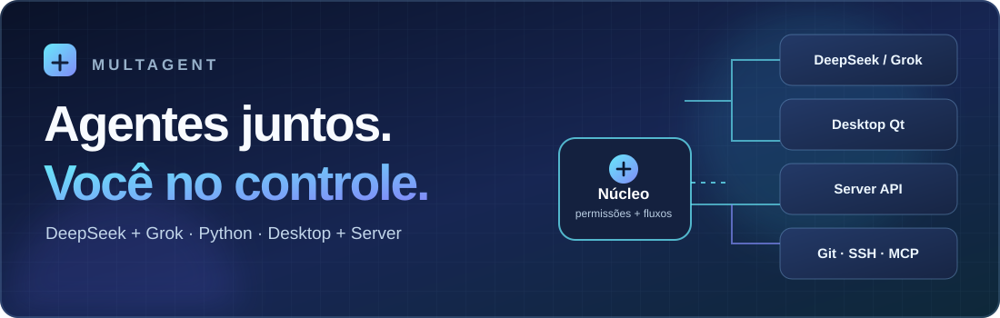
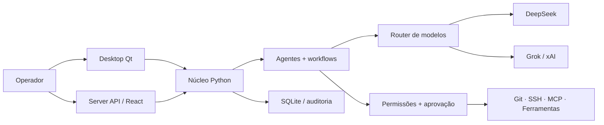

<div align="center">



# MultAgent

### Organize agentes de IA, distribua tarefas e mantenha o controle sobre ferramentas, custos e permissões.

**Uma plataforma multiagente em Python, com Desktop nativo e uma edição Server independente.**

[](https://github.com/llongaray/MultAgent/actions/workflows/python-ci.yml)
[](https://github.com/llongaray/MultAgent/actions/workflows/desktop-ci.yml)
[](https://github.com/llongaray/MultAgent/actions/workflows/server-ui-ci.yml)
[](pyproject.toml)
[](#estado-do-projeto)

**[Começar](#início-rápido) · [Funcionalidades](#o-que-o-multagent-oferece) · [Arquitetura](#como-funciona) · [Documentação](#documentação) · [Contribuir](CONTRIBUTING.md)**

</div>

> [!IMPORTANT]
> **Projeto em desenvolvimento (pré-alpha, `0.0.1.dev0`).** Há código real para as prioridades P0–P9, mas nem todos os recursos passaram por homologação de ponta a ponta. **Não há instalador independente, release binária nem licença final publicada.** As instruções abaixo executam o código-fonte em ambiente de desenvolvimento.

## O que é o MultAgent?

O **MultAgent** é um projeto de plataforma multiagente: você cria **funcionários de IA**, organiza equipes e workflows, escolhe quais provedores podem atuar e administra os recursos que cada agente pode acessar. A arquitetura combina **DeepSeek** e **Grok (xAI)** sob um núcleo Python compartilhado, com trilhas de execução, auditoria e confirmação humana antes de ações sensíveis.

A proposta é transformar tarefas complexas em etapas coordenadas — por exemplo, separar análise, implementação e revisão de um projeto de software — sem entregar acesso irrestrito ao computador ou às integrações. **Os workflows e as integrações existentes são uma base de desenvolvimento; não representam um assistente autônomo de produção já homologado.**

### Duas formas de executar

| Edição | Interface | Tecnologia | Uso previsto |
| --- | --- | --- | --- |
| **Desktop** | Janela nativa; **não inicia servidor HTTP local** | Python + PySide6/Qt | Operação local no Windows ou Linux, administração de agentes, permissões e execuções |
| **Server** | API HTTP + painel web separado | FastAPI + React/TypeScript (Vite) | Execução headless e acesso por navegador em ambiente administrado; autenticação inicial e painel em evolução |

[Entenda as diferenças entre Desktop e Server](org/04-distribuicao/04-edicoes-desktop-server.md).

## O que o MultAgent oferece?

| Componente | O que existe no repositório | Estado |
| --- | --- | --- |
| **Agentes e equipes** | Cadastro de agentes, equipes, hierarquia e orquestração de tarefas por dependências (DAG) | Base implementada |
| **DeepSeek + Grok** | Adaptadores de API, propostas de ferramentas, modos exclusivos ou híbridos e estimativa de consumo | Testes simulados; chamadas reais dependem de credenciais |
| **Desktop Qt** | Painéis de início, funcionários, integrações, permissões, execuções e logs | GUI inicial; testes automatizados de smoke |
| **Server + dashboard** | CLI, FastAPI, autenticação, sessões, controle de origem e painel React | Funcionalidades iniciais; implantação real pendente |
| **Git e ferramentas** | Acesso a repositórios com grants; operações Git locais e shell Linux restrito | Sandbox Linux dependente do host; Windows sem equivalente aprovado |
| **GitHub, GitLab, Bitbucket e SSH** | Conectores por repositório, operações permitidas e verificação de host key SSH | OAuth interativo e testes externos ainda pendentes |
| **MCP, plugins e skills** | Cliente MCP remoto com autorização, catálogo de plugins por checksum e skills importadas em quarentena | **Execução de plugins desativada** até sandbox validado |
| **Automação de aplicativos** | Adaptadores Windows UI Automation e Linux AT-SPI, seleção de janela, consentimento e auditoria | Testes de contrato; validação em aplicativos reais pendente |
| **Broker de privilégios** | IPC autenticado, tickets assinados de uso único e operações administrativas pré-definidas | Sem instalação de helper elevado nem homologação UAC/sudo |
| **CI e governança** | Testes Python Windows/Linux, smoke Qt, build React e verificação do fluxo de PRs | Checks executáveis; proteção administrativa de branches depende do GitHub |

Para verificar exatamente **o que está implementado e o que falta**, consulte a [matriz técnica P5–P8](org/07-p5-p8-implementacao.md) e o [estado operacional P9](docs/p9-operations.md).

## Início rápido

### Requisitos

- **Python 3.11 ou superior**, Git e ambiente virtual Python recomendado.
- **Windows 10/11 ou Linux com sessão gráfica** para a edição Desktop; Linux/Ubuntu e Windows são exercitados na CI, mas isso não substitui testes manuais de distribuição.
- **Node.js e npm** apenas se quiser compilar o painel React da edição Server.
- Chaves de API próprias de DeepSeek/xAI **somente** ao testar chamadas aos provedores; não são necessárias para instalar e inspecionar a interface.

### 1. Baixar o projeto

```bash
git clone https://github.com/llongaray/MultAgent.git
cd MultAgent
python -m venv .venv
```

Ative o ambiente virtual apropriado ao seu terminal:

| Sistema | Comando |
| --- | --- |
| Windows PowerShell | ` .\.venv\Scripts\Activate.ps1 ` |
| Linux (bash/zsh) | `source .venv/bin/activate` |

> Se preferir não usar ambiente virtual, execute os comandos `python -m pip` diretamente em um ambiente Python isolado de sua escolha.

### 2. Abrir a edição Desktop

```bash
python -m pip install -e ".[desktop]"
multagent
```

O comando `multagent` abre uma janela **Qt nativa** e não cria um servidor web local. Para diagnósticos:

```bash
multagent-cli doctor
multagent-cli version
multagent-cli logs
```

### 3. Executar a edição Server (alternativa)

Em um clone do projeto, instale o backend e compile o painel web:

```bash
python -m pip install -e ".[server]"
cd frontend-server
npm install
npm run build
cd ..
```

Inicialize uma configuração local (a senha administrativa será solicitada, com no mínimo 12 caracteres) e depois inicie o processo:

```bash
multagent-server init --bind 127.0.0.1 --port 8765
multagent-server start
```

A interface web compilada é servida pela aplicação Server quando disponível. **Mantenha o bind local para desenvolvimento.** Para endereços externos, a configuração exige TLS e hosts explicitamente autorizados; isso **não** substitui a revisão de segurança, implantação de processos, monitoramento e controle de acesso necessários em produção.

[Guia de instalação e CLI](org/04-distribuicao/01-instalacao-cli.md) · [Detalhes das edições](org/04-distribuicao/04-edicoes-desktop-server.md)

## Como funciona?

O núcleo do MultAgent é independente das duas interfaces. As tarefas são representadas por entidades tipadas, orquestradas em workflows e encaminhadas a provedores por um roteador de modos. Ferramentas e integrações passam por **grants, validações de escopo e aprovações**, conforme a operação.



A decisão de um modelo de **pedir** uma ferramenta não autoriza sua execução. O usuário e a política de segurança continuam controlando o acesso. A arquitetura prevê trabalho colaborativo entre agentes, mas os fluxos realmente disponíveis dependem da etapa implementada e validada.

[Arquitetura completa](org/02-arquiteturas/01-visao-componentes.md) · [Hierarquia e processos](org/02-arquiteturas/10-hierarquia-processos-e-politicas.md) · [Roteamento e custos](org/02-arquiteturas/05-roteamento-e-custos.md)

## Segurança e controle

- **Permissões explícitas por workspace, agente, recurso e ação.** Ausência de autorização deve resultar em bloqueio.
- **Credenciais fora do código.** Tokens são referências a cofres; não inclua chaves, senhas ou arquivos de configuração sensíveis em commits.
- **Confirmação humana em operações críticas.** Recursos remotos, ações em aplicativos e alterações privilegiadas exigem autorização; consentimento não é inferido de respostas do modelo.
- **Menor privilégio.** O broker não entrega shell administrativo à IA; execução de plugins não confiáveis permanece desabilitada.
- **Custos de IA.** DeepSeek e xAI podem cobrar por tokens/ferramentas; a estimativa de consumo **não** equivale a um teto financeiro garantido.

**Aviso de homologação:** proteção GitHub de `dev/hml/main` não se torna efetiva só por existir um workflow; rulesets e labels ainda exigem configuração administrativa. Consulte [OPS-P0](docs/ops-p0-apply.md).

## Estado do projeto

| Item | Situação |
| --- | --- |
| Versão do pacote | `0.0.1.dev0` — desenvolvimento |
| Prioridades técnicas | Código-base P0–P9 versionado; aceites operacionais separados |
| Testes automatizados | GitHub Actions para Python (Ubuntu/Windows), Qt e build React |
| Release pronta para instalação | **Ainda não publicada** |
| Instaladores `.exe`, `.deb` e similares | **Ainda não disponíveis** |
| Licença | **Não definida/publicada no repositório**; código público não significa licença de reutilização concedida |
| Integrações reais e privilégio OS | Homologação e implantação adicionais necessárias |

Acompanhamento da implementação: [Trello — MultAgent P0–P9](https://trello.com/b/1Ne1r8A2/multagent-desenvolvimento-e-prs-p0-p9). Os cartões registram evidências de PRs, testes, pendências e aceites.

## Desenvolvimento e testes

No clone local, com Python e dependências de desenvolvimento:

```bash
python -m pip install -e ".[dev]"
python -m pytest -q
python -m compileall -q src tests
python -m ruff check src/multagent tests/unit --select E4,E7,E9,F
```

A CI executa combinações Python 3.11/3.13 em Ubuntu/Windows, smoke Qt com Python 3.11 nos dois sistemas e o build React. Não anuncia cobertura total de tipos, executáveis de distribuição ou testes externos com credenciais.

**Fluxo do projeto oficial:** branch de módulo → PR para `dev` → promoção `dev` → `hml` → `main` após autorização. Leia o [guia de contribuição](CONTRIBUTING.md) e a [política de PRs](org/06-desenvolvimento/05-fluxo-de-prs-e-prioridades.md).

## Documentação

| Guia | Conteúdo |
| --- | --- |
| [Mapa mestre](org/README.md) | Índice completo para navegar pelos documentos técnicos |
| [Fundamentos de multiagentes](org/00-fundamentos/README.md) | LLM, agentes, ferramentas, tokens e RAG |
| [Provedores](org/01-provedores/README.md) | Integração DeepSeek e Grok/xAI |
| [Arquitetura](org/02-arquiteturas/README.md) | Router, domínio, políticas, delegação e topologia |
| [Desktop e Server](org/04-distribuicao/04-edicoes-desktop-server.md) | Diferenças, instalação e implantação |
| [Integrações](org/05-integracoes/README.md) | Git, SSH, MCP, plugins, skills e autorização |
| [Matriz de implementação P5–P8](org/07-p5-p8-implementacao.md) | Entregas de código e limitações atuais |
| [P9: automação e privilégios](docs/p9-operations.md) | Estado dos backends de acessibilidade e do broker |
| [Contribuição e desenvolvimento](CONTRIBUTING.md) | Convenções de branches, testes e pull requests |

## Perguntas frequentes

<details>
<summary><strong>O MultAgent é gratuito? Preciso pagar o DeepSeek ou o Grok?</strong></summary>

O código do projeto pode ser consultado publicamente, mas **não há uma licença de uso/reutilização publicada**. Para fazer chamadas às APIs externas, você precisa de credenciais próprias e está sujeito à cobrança e aos termos de cada provedor. O MultAgent não inclui créditos de API.

</details>

<details>
<summary><strong>O Desktop abre um navegador ou usa um servidor local?</strong></summary>

Não. A edição Desktop usa PySide6/Qt diretamente. A edição Server é separada e usa FastAPI/React, portanto possui interface HTTP própria.

</details>

<details>
<summary><strong>Já posso baixar um executável para Windows ou Ubuntu?</strong></summary>

Ainda não. O código-fonte pode ser instalado em um ambiente de desenvolvimento com Python. **Não há release ou instalador empacotado publicado**; não utilize downloads não oficiais apresentados como binários do MultAgent.

</details>

<details>
<summary><strong>Os agentes podem modificar meu computador ou executar comandos como administrador?</strong></summary>

Não livremente. As ferramentas disponíveis são condicionadas a grants, validações e aprovações. A automação por acessibilidade e o broker de privilégio têm componentes iniciais, mas a validação completa em aplicativos e hosts reais não foi concluída. A IA não recebe shell de administrador permanente.

</details>

<details>
<summary><strong>O que ainda falta antes de usar em produção?</strong></summary>

Entre outras etapas: homologação E2E com credenciais reais, OAuth e fluxos de instalação, testes completos de Desktop/Server em ambientes reais, sandbox equivalente em Windows, regras administrativas efetivas no GitHub, licença definida e binários publicados. Confira a documentação de [P5–P8](org/07-p5-p8-implementacao.md) e [P9](docs/p9-operations.md).

</details>

---

<div align="center">

**MultAgent — agentes coordenados, execução auditável, controle humano.**

[Repositório](https://github.com/llongaray/MultAgent) · [Documentação](org/README.md) · [Reportar problema](https://github.com/llongaray/MultAgent/issues) · [Contribuir](CONTRIBUTING.md)

<sub>Projeto em desenvolvimento. Não confunda código versionado com distribuição ou homologação para produção.</sub>

</div>
