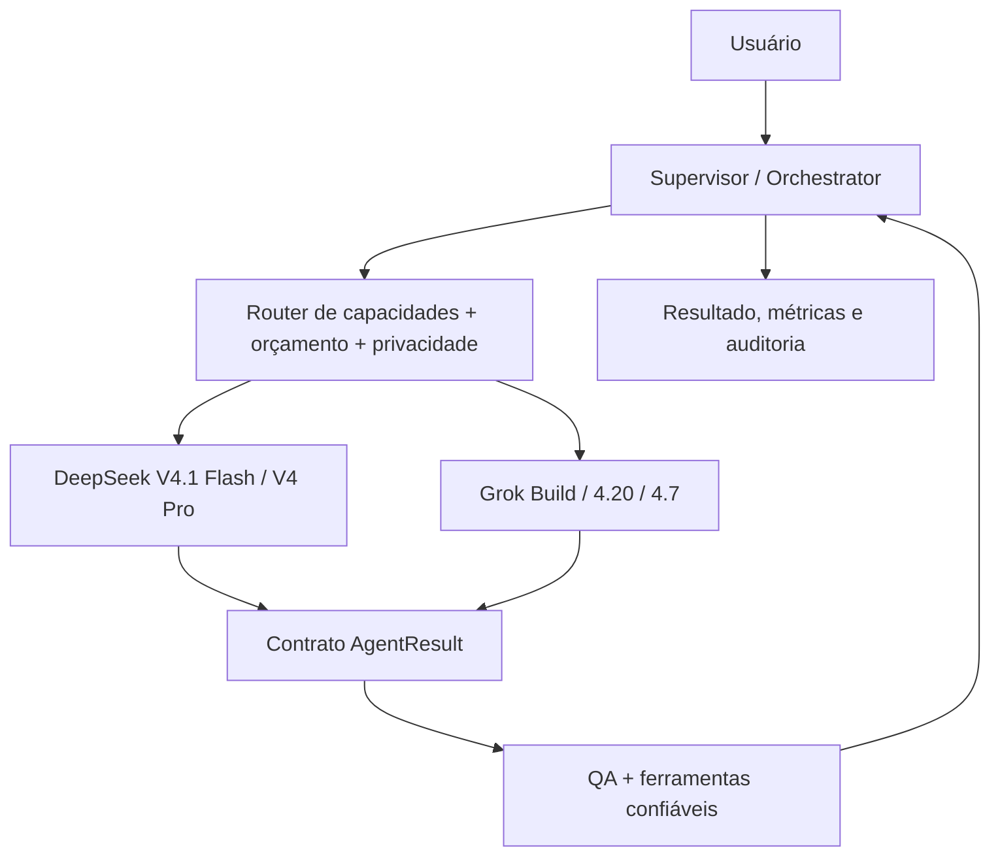

# MultAgent — modo Hybrid (DeepSeek + Grok)

## Proposta

Um supervisor próprio distribui trabalhos entre vários agentes. Cada agente opera como unidade independente (perfil + instruções + contexto + ferramentas), **sem chamadas diretas de um modelo ao outro**. A comunicação ocorre por eventos e artefatos neutros no backend.

## Roteamento inicial recomendado

| Tarefa | Provedor preferencial | Backup permitido |
|---|---|---|
| Extração, classificação, resumo | DeepSeek Flash | Grok 4.20 NR **somente se permitido** |
| Plano complexo | DeepSeek V4 Pro ou Grok 4.20 Reasoning | outro mediante política |
| Codificação inicial | DeepSeek Flash (baixo custo) | Grok Build 0.1 para tarefas especializadas |
| Code review independente | Provedor **diferente** do autor, em tarefas críticas | mesmo provedor com revisão determinística |
| Pesquisa com X | Grok com `x_search` autorizado | não existe equivalência nativa para acesso a X |
| MCP interno/privado | Tool Gateway + MCP client local | nunca enviar rede privada ao MCP remoto xAI automaticamente |
| MCP remoto público confiável | Grok nativo (opt-in) ou gateway próprio | depende da classificação dos dados |
| Análise visual | DeepSeek Flash ou Grok com visão | depende do tipo de arquivo e budget |

## Comparação útil: o que muda de provedor

| Contrato | DeepSeek | Grok |
|---|---|---|
| Base URL | `https://api.deepseek.com` | `https://api.x.ai/v1` |
| Endpoint recomendado do projeto | Chat Completions | Responses API |
| Estado server-side | Respostas stateless | `previous_response_id` opcional sob armazenamento |
| Ferramenta Function Calling | aplicação executa | aplicação executa |
| MCP remoto nativo | não na integração documentada | suporta `type=mcp` na Responses |
| Métrica de custo | estimar `usage × pricebook` | `usage.cost_in_usd_ticks` quando presente |
| Ferramentas web | Search/Fetch API separadas | `web_search` gerenciado na Responses |
| Raciocínio interno | formato/mode DeepSeek | `reasoning.encrypted_content` em Grok 4.7 Responses |

## Passo a passo de uma execução híbrida

1. Usuário submete tarefa em `hybrid` com `allowed_providers=["deepseek","grok"]`.
2. Supervisor classifica subtarefas: dificuldade, privacidade, ferramenta, tamanho de contexto, SLA e risco.
3. Router escolhe modelo **da lista autorizada** conforme matriz de capacidades e orçamento.
4. Workers executam somente com o contexto mínimo. Mensagens e formato de cada fornecedor são montados no seu adapter.
5. Cada worker devolve `AgentResult` neutro, com texto, artefatos, fontes e flags de qualidade.
6. Critic independente avalia resultado, idealmente em provedor distinto **se houver consentimento e orçamento**.
7. Se precisar de ferramenta, orquestrador executa pelo Tool Gateway, não por texto de modelo; ferramentas xAI geridas só são habilitadas pela política.
8. Resultado final é consolidado; custos estimados/reais são reconciliados no `UsageLedger`.

## Privacidade em cross-provider

NUNCA envie `reasoning.encrypted_content` do Grok para DeepSeek nem o raciocínio interno de um modelo ao outro. Encaminhe apenas resumos/artefatos de tarefa autorizados, minimizados e com trilha de auditoria. Se o usuário selecionar `deepseek_only` ou `grok_only`, **não há cross-provider nem fallback cruzado**.

## Revisão cruzada: custo versus benefício

Dupla checagem independente pode reduzir erros, mas também duplica ou amplia custos. Use para código crítico, requisitos difíceis e alterações destrutivas; para tarefas triviais prefira checks determinísticos e um único worker.

## Armadilhas

- Misturar diretamente `messages` (DeepSeek) e `input/output` (Grok) cria bugs; **não** use mesmo payload sem adapter.
- Grok com `store=true` tem consequências de retenção: respeitar decisão de privacidade e contrato.
- Longo contexto Grok (≥200k tokens) muda tarifa de toda a requisição.
- Modelos Grok internos multiagente não substituem o roteador híbrido do MultAgent.
- Ferramentas xAI podem cobrar separadamente dos tokens; controlar `max_turns` e habilitar só as necessárias.

Próximos documentos: [Router e preço](05-roteamento-e-custos.md), [interfaces](06-contratos-e-adapters.md) e [configuração](08-configuracao-e-perfis.md).
