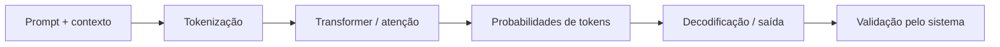

# 01 · IA generativa e LLM: como realmente funcionam

**[← Mapa Mestre](../README.md)** · **[↑ Fundamentos](README.md)** · [Próximo: agentes e ferramentas →](02-o-que-e-multiagente.md)

## Inteligência artificial, aprendizado de máquina e LLM

**IA** é o campo que desenvolve sistemas capazes de realizar atividades associadas a percepção, predição, planejamento e linguagem. **Aprendizado de máquina (ML)** é um conjunto de técnicas que ajusta parâmetros a partir de dados. **IA generativa** produz novos conteúdos; **LLM** é um modelo especializado em linguagem que normalmente também lida com instruções, código e, conforme sua arquitetura, outras modalidades.

Em uma simplificação operacional, durante o treinamento o modelo aprende padrões estatísticos em grandes conjuntos de dados. Durante a **inferência**, ele recebe tokens de entrada, transforma-os em representações numéricas, aplica camadas da rede (frequentemente com mecanismo de atenção em Transformers) e produz probabilidades para próximos tokens; a decodificação seleciona tokens sucessivos.

Isso explica por que um LLM consegue completar código e argumentar, mas também pode alucinar. Ele **não faz uma consulta factual garantida** em cada palavra produzida nem tem acesso automático à internet, ao seu filesystem ou ao banco de dados.

## Anatomia de uma requisição

- **Prompt:** instruções do sistema/desenvolvedor/usuário, exemplos e dados relevantes.
- **Token:** unidade de processamento que pode representar uma palavra, pedaço de palavra, pontuação ou unidade multimodal. Não é igual a um caractere.
- **Context window:** máximo de tokens processados por operação, considerando restrições de entrada, saída e recursos do modelo.
- **Temperature/top_p:** parâmetros de amostragem quando o modelo/API suporta; mais aleatoriedade não implica mais criatividade útil em todas as tarefas.
- **Inference:** custo computacional para calcular a resposta a partir do prompt.
- **Cached input:** parte repetida do contexto reutilizada pelo provedor, quando ele oferece cache.
- **Fine-tuning:** atualização de parâmetros para uma tarefa; diferente de simplesmente injetar documentos no prompt.
- **RAG:** buscar material externo e fornecê-lo como contexto, sem treinar novamente os pesos.

## Por que contexto, saída e raciocínio importam no orçamento?

Cada etapa do MultAgent pode consumir tokens de entrada e de saída; repetir histórico completo multiplicará custo/latência. Há modelos com modos de raciocínio que usam mais recursos; ferramentas de pesquisa, execução e armazenamento podem ser cobradas separadamente. Portanto, é necessário projetar **memória externa, resumos e orçamento por tarefa**.

## O que um LLM não deve decidir sozinho

Não executar SQL destrutivo, compras, atualizações no GitHub ou shell porque uma frase o solicitou. A saída do LLM é **não confiável até validada**. O backend deve checar tipos, esquema, identidade, permissões, idempotência, limites e necessidade de aprovação humana.

**Leituras relacionadas:** [O que é multiagente](02-o-que-e-multiagente.md) · [Contratos/adapters](../02-arquiteturas/06-contratos-e-adapters.md) · [Roteamento e custo](../02-arquiteturas/05-roteamento-e-custos.md).

**[← Voltar ao Mapa Mestre](../README.md)**
