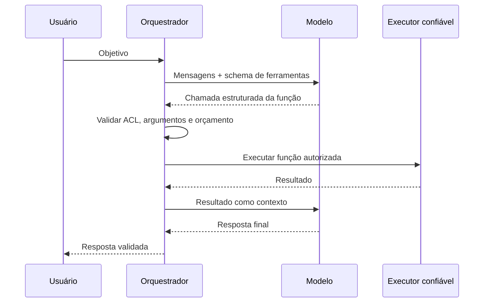

# 02 · Agentes, multiagentes, MCP, RAG e orquestração

**[← Mapa Mestre](../README.md)** · **[↑ Fundamentos](README.md)** · [Anterior: LLM](01-o-que-e-llm.md) · [Próximo: escolha de provedores](03-por-que-deepseek-e-grok.md)

## Modelo versus agente

**Modelo:** a rede que gera respostas a partir de mensagens. **Agente:** uma aplicação ou unidade lógica que usa um modelo com uma **função**, ferramentas permitidas, condições de término, estado e regras para realizar uma tarefa. **Multiagentes:** vários agentes executam papéis especializados com troca de dados por um orquestrador. Não é obrigatório usar modelos diferentes; dez agentes podem usar o mesmo modelo com diferentes instruções e ferramentas.

## Papéis típicos

| Papel | Responsabilidade | Saída |
|---|---|---|
| Supervisor / Planner | decompor objetivo em tarefas e dependências | plano estruturado |
| Researcher | reunir evidências com ferramentas autorizadas | fontes e notas |
| Coder / Executor | produzir artefatos ou sugestões | código, arquivos e relatórios |
| Critic / Reviewer | avaliar qualidade e riscos | observações e aprovações |
| Summarizer | consolidar resultados | resposta final |

O **orquestrador** é o software que controla estados, ordem das etapas, custo, paralelismo, segurança e comunicação. Ele não é necessariamente outro LLM; a política de roteamento pode ser determinística.

## Tool Calling: modelo solicita, software executa

O modelo **não recebe por padrão** acesso ao banco, sistema operacional, GitHub ou web. É a integração que fornece ferramentas.

## MCP: Model Context Protocol

Padrão aberto para descrever e conectar **ferramentas, recursos e prompts**. Um servidor MCP publica operações; um cliente MCP as descobre e utiliza. No projeto, o **Tool Gateway** intermedia chamadas MCP, aplica permissões e mantém logs. Grok/xAI também possui MCP remoto nativo para servidores acessíveis à xAI; DeepSeek usa um cliente MCP no nosso backend para integração semelhante. As duas abordagens têm riscos diferentes de transporte e exposição de dados.

## RAG, memória e persistência

**RAG** (*Retrieval-Augmented Generation*) procura documentos relevantes (por texto/índices vetoriais) e incorpora trechos ao prompt. **Memória de execução** é persistência de tarefas, mensagens resumidas, artefatos e estado pelo MultAgent. A memória não deve depender exclusivamente da retenção do provedor; versionamento, TTL e regras de privacidade pertencem ao backend.

## Padrões de colaboração

- **Pipeline:** planner → executor → reviewer, tarefas sequenciais e rastreáveis.
- **Paralelo:** múltiplos especialistas recebem subtarefas independentes e retornam resultados.
- **Supervisor-worker:** supervisor atribui tarefas e avalia progresso dentro de limites.
- **Debate/revisão cruzada:** segundo agente revisa resultado, apenas quando melhoria potencial justificar custo.
- **Híbrido multi-provedor:** roteador usa DeepSeek ou Grok para cada perfil respeitando política de dados.

## Limites essenciais

Impor `max_steps`, `max_tool_calls`, `max_cost_usd`, timeout, rate limit, chave de idempotência e autorização por tenant. O agente revisor **não substitui testes determinísticos**. Ações destrutivas exigem consentimento explícito.

**Leituras relacionadas:** [Topologia](../02-arquiteturas/01-visao-componentes.md) · [DeepSeek e MCP](../01-provedores/deepseek/05-multiagentes-mcp.md) · [Grok e MCP remoto](../01-provedores/grok/04-ferramentas-mcp.md).

**[← Voltar ao Mapa Mestre](../README.md)**
