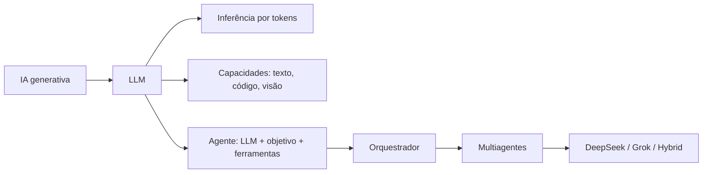

# 00 · Fundamentos de IA e sistemas multiagentes

**[← Voltar ao Mapa Mestre](../README.md)**

Esta seção responde às perguntas técnicas fundamentais antes de escolher modelo, SDK ou stack. Você pode percorrê-la do início ao fim ou selecionar um tópico.

| Ordem | Material | O que você vai aprender |
|---|---|---|
| 1 | **[O que é LLM](01-o-que-e-llm.md)** | aprendizado, tokens, contexto, inferência, limitações |
| 2 | **[O que é multiagente](02-o-que-e-multiagente.md)** | agente, orquestrador, function calling, MCP, RAG |
| 3 | **[Por que DeepSeek e Grok](03-por-que-deepseek-e-grok.md)** | custo-benefício, seleção de capacidades e ressalvas |
| 4 | **[Glossário](04-glossario.md)** | consulta rápida de siglas e termos |
| 5 | **[Propósito e casos reais](05-proposito-e-casos-de-uso.md)** | missão do MultAgent: funcionários virtuais com recursos/integrações autorizadas |

## Mapa dos conceitos

## Próximo caminho

Após entender esses conceitos, consulte [missão e casos de uso](05-proposito-e-casos-de-uso.md), [integrações e catálogo](../05-integracoes/README.md), [provedores DeepSeek](../01-provedores/deepseek/README.md), [Grok](../01-provedores/grok/README.md) ou [arquitetura geral](../02-arquiteturas/README.md).

[← Mapa Mestre](../README.md)
