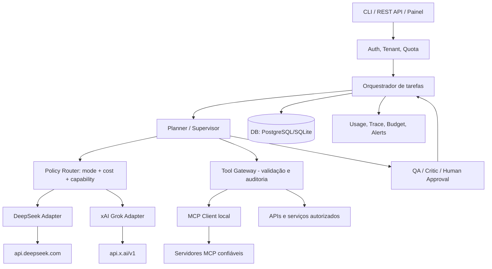

> **Navegação:** [← Mapa mestre](../README.md) · [↑ Arquiteturas](README.md) · [Fundamentos](../00-fundamentos/README.md) · [Provedores](../01-provedores/deepseek/README.md)

# Topologia e componentes do MultAgent

## Diagrama lógico

Quando o Grok receber um MCP remoto nativo, a xAI pode conectar diretamente seu serviço a um MCP permitido. Mesmo nesse cenário, **o orquestrador deve controlar escopo e aprovação** e não deve delegar operações críticas sem intervenção.

## Responsabilidades

| Componente | Função | Não faz |
|---|---|---|
| API Gateway | autenticação, autorização, rate limit e schema da tarefa | decidir segredos com prompt |
| Orchestrator | criar execução, estados, fluxo e consolidação | executar ferramentas sem controle |
| Supervisor/Planner | decompor tarefa e coordenar workers | ignorar orçamento ou política |
| Policy Router | escolher provedor e modelo, veto de privacidade, fallback | experimentar provedores proibidos |
| Provider Adapter | traduzir request/resposta, erros, tool calls, uso | guardar dados indefinidamente |
| Tool Gateway | schema, tenant, allowlist, idempotência, aprovação | confiar em JSON do modelo |
| Worker | executar subtarefa autorizada com retries | fazer efeitos colaterais em retries cegos |
| QA/Critic | avaliar artefatos e pedir correções justificadas | aceitar autoavaliação como prova |
| Storage | histórico, artefatos, eventos e metadados | virar repositório indiscriminado de PII |
| Usage Ledger | cálculo e reconciliação de custo | tratar estimativa como cobrança real |

## Fluxo normal

1. Requisição recebe `run_id`, `tenant_id` e `mode` explicitamente permitido.
2. Orquestrador valida objetivo, ferramentas autorizadas, dados de entrada e custo máximo.
3. Supervisor decompõe o objetivo em subtarefas com contrato de entrada/saída.
4. Router seleciona modelo para cada subtarefa com base em perfis, catálogo de modelos e orçamento.
5. Worker usa adapter correto; retornos viram `AgentResult` neutro.
6. Se houver tool call, o Tool Gateway aplica schema/ACL/consentimento e guarda trilha idempotente.
7. Revisor verifica critérios determinísticos (testes, schema, fontes) e encaminha correção se necessário.
8. Orquestrador compõe resposta, grava gastos e fecha `run.status`.

## Estados e eventos

`queued -> running -> waiting_tool/waiting_approval -> running -> completed|failed|cancelled`. Cada transição gera evento monotônico. Retentativas precisam de chave de idempotência (`run_id` + `task_id` + `tool_call_id`); resultado externo não confiável não é permissão para replanejamento ilimitado.

## Segurança entre provedores

- Não enviar tokens nem credenciais de um provider para o outro.
- Nunca copiar raciocínio interno/criptografado do Grok para DeepSeek como prompt. Compartilhar somente artefatos finais/sumários autorizados.
- Conteúdos de usuários e MCPs externos são não confiáveis; limpar e limitar ferramentas.
- Permitir ao usuário escolher **filtro de provedores** e nível de privacidade; rejeitar roteamento que viole esse filtro.

Próxima leitura: [Modos de execução](README.md).

---

**Continuar:** [Mapa mestre](../README.md) · [Arquiteturas](README.md) · [Comparação DeepSeek/Grok](../00-fundamentos/03-por-que-deepseek-e-grok.md) · [Arquiteturas](README.md).
