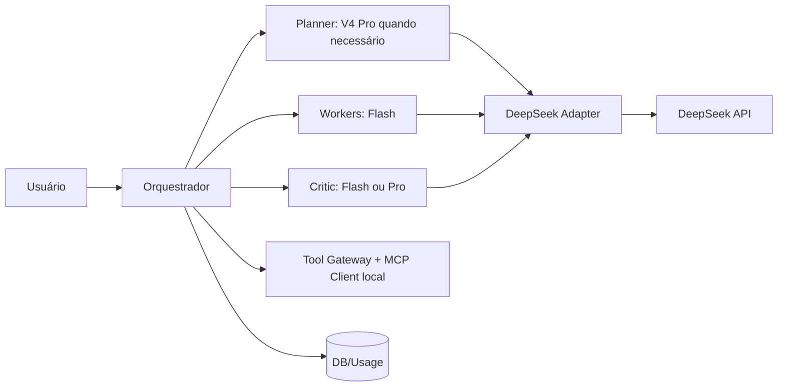

> **Navegação:** [← Mapa mestre](../README.md) · [↑ Arquiteturas](README.md) · [Fundamentos](../00-fundamentos/README.md) · [Provedores](../01-provedores/deepseek/README.md)

# MultAgent — modo DeepSeek Only

## Objetivo

Executar múltiplos agentes independentes com apenas a API oficial da DeepSeek, mantendo orquestrador, memória, ferramentas e persistência no backend do MultAgent. Nenhuma solicitação deve ser enviada à xAI quando `mode="deepseek_only"`.

## Componentes

## Papéis iniciais

| Agente | Modelo padrão proposto | Quando subir |
|---|---|---|
| `planner` | `deepseek-flash` | `deepseek-v4-pro` em tarefas realmente complexas |
| `researcher` | `deepseek-flash` + Search/Fetch autorizado | Pro se exigir síntese crítica |
| `coder` | `deepseek-flash` | Pro para bugs arquiteturais/revisão |
| `validator` | `deepseek-flash` + validadores reais | Pro mediante falhas repetidas |
| `summarizer` | `deepseek-flash` | Não escalar sem necessidade |

**Por que é econômico?** Flash fora do pico custa $0,15 / 1M tokens de entrada não cacheada e $0,60 / 1M de saída; Pro $0,66 / $1,98. Reavaliar preços no deploy. [Modelos](../01-provedores/deepseek/01-modelos-e-custos.md).

## Contrato de chamada

- Default: Chat Completions em `https://api.deepseek.com/chat/completions` (stateless).
- `messages` é montado pelo backend, sem pressupor persistência do provedor.
- `function tool calls` retornam intenções; o backend valida e executa.
- Para busca web, o backend pode chamar `/v1/tools/search`/`fetch`; são APIs cobradas por requisição, distintas do texto.
- MCP **não é executado nativamente pelo DeepSeek**; o backend usa cliente MCP próprio e converte ferramentas para Function Calling.

## Passo a passo da execução

1. Registrar `mode=deepseek_only` e lista permitida `["deepseek"]`.
2. Definir orçamento, `max_agent_steps` e whitelist de ferramentas.
3. Planner divide tarefa em etapas; cada uma tem ID, critérios de sucesso e dependências.
4. Workers executam paralelamente somente quando não houver dependências nem efeitos colaterais.
5. Tool Gateway controla funções e MCP; registra autorização.
6. Validadores determinísticos (lint, testes, schema, fontes) precedem revisão de LLM.
7. Retornar resposta final e custos estimados a partir de `usage`; registrar modelo e horário (pico/fora de pico).

## Cenário exemplo

Solicitação: "Leia requisitos, gere documentação e avalie riscos". Planner Flash cria três subtarefas; Worker A extrai requisitos, Worker B cria MD, Critic valida consistência; todos chamam DeepSeek. Pode-se subir só a revisão crítica para Pro caso testes indiquem melhoria.

**Recursos relacionados:** [DeepSeek docs](../01-provedores/deepseek/README.md), [contratos](06-contratos-e-adapters.md), [política de roteamento](05-roteamento-e-custos.md).

---

**Continuar:** [Mapa mestre](../README.md) · [Arquiteturas](README.md) · [Comparação DeepSeek/Grok](../00-fundamentos/03-por-que-deepseek-e-grok.md) · [Arquiteturas](README.md).
