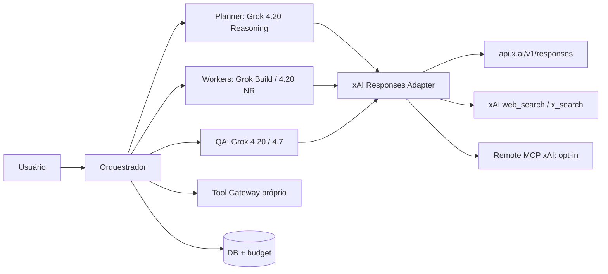

> **Navegação:** [← Mapa mestre](../README.md) · [↑ Arquiteturas](README.md) · [DeepSeek](../01-provedores/deepseek/README.md) · [Grok/xAI](../01-provedores/grok/README.md)

# MultAgent — modo Grok Only

## Objetivo

Executar supervisor, workers, revisão e ferramentas apenas com a API xAI/Grok. `mode="grok_only"` deve impedir qualquer chamada DeepSeek.

## Topologia

## Papéis/modelos para custo-benefício

| Agente | Modelo sugerido | Motivo |
|---|---|---|
| `planner` | `grok-4.20-0309-reasoning` | raciocínio e custo inferior a 4.7 |
| `researcher` | `grok-4.20-multi-agent-0309` somente em pesquisa profunda | subagentes do provedor; custo pode crescer via ferramentas |
| `coder` | `grok-build-0.1` | preço inferior e orientação a engenharia |
| `executor` | `grok-4.20-0309-non-reasoning` | chamadas estruturadas e tarefas rápidas |
| `critic` | `grok-4.20-0309-reasoning` | validação contextual |
| `premium` | `grok-4.7` | escalonar somente quando benchmarks justificarem |

**Importante:** Modelos podem não estar todos acessíveis à sua chave e região; aplique `GET /v1/models`. O `grok-4.20-multi-agent` contém uma forma de colaboração interna **do serviço** e não substitui o nosso orquestrador, nem é obrigatório para `grok_only`.

## Responses API e estado

- Base `https://api.x.ai/v1`, endpoint `/responses`.
- O Grok permite `previous_response_id` em respostas armazenadas (retenção declarada de 30 dias). Para projeto com privacidade reforçada prefira `store=false` e histórico próprio, evitando `previous_response_id`; em modelos com reasoning criptografado, preserve os itens necessários ao continuar stateless.
- Cache: `prompt_cache_key` estável por conversa.
- Tools: Function Calling local; ferramentas de busca e MCP remoto podem ser geridos pelo servidor xAI, conforme contratos e políticas.

## Sequência proposta

1. Criar execução e validar tenant, budget, modo.
2. Selecionar Grok 4.20 Reasoning para plano inicial.
3. Executar workers sob roteamento exclusivamente xAI.
4. Restringir ferramentas server-side e MCP por endpoint confiável, escopo e custo.
5. Revisar por regras determinísticas + modelo critic sem loops ilimitados.
6. Emitir artefatos e registrar `usage.cost_in_usd_ticks` e `tool_usage_details`.
7. Se a xAI estiver indisponível, **falhar controladamente** ou aguardar: não mudar para DeepSeek neste modo.

**Fontes:** [Grok docs](../01-provedores/grok/README.md), [modelos](../01-provedores/grok/01-modelos-e-custos.md), [ferramentas](../01-provedores/grok/04-ferramentas-mcp.md).

---

**Leituras relacionadas:** [Mapa mestre](../README.md) · [Fundamentos](../00-fundamentos/README.md) · [Modelos DeepSeek](../01-provedores/deepseek/README.md) · [Modelos Grok](../01-provedores/grok/README.md).
