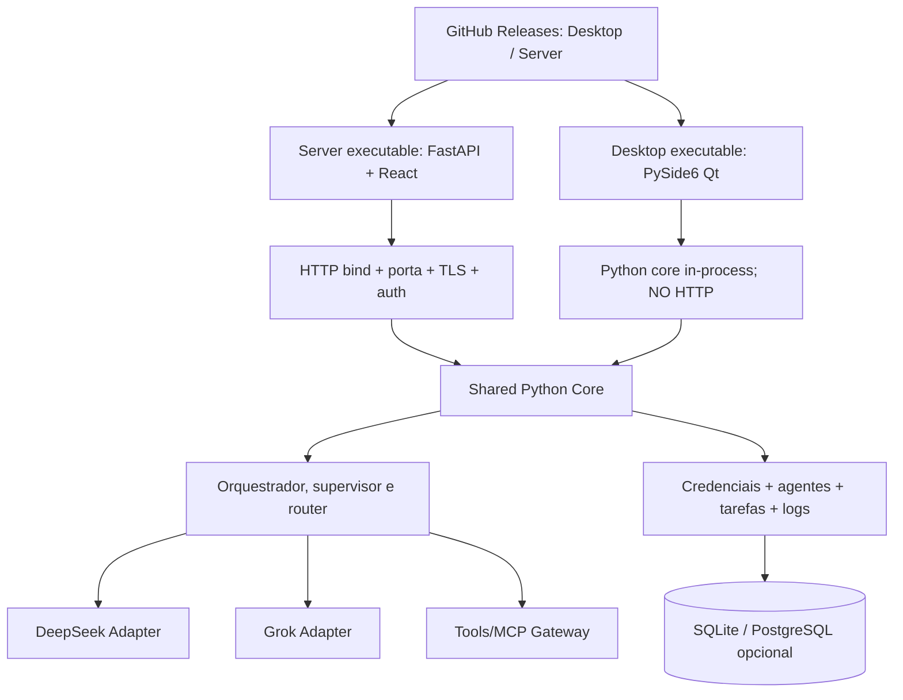

# 09 · Arquitetura de software — duas interfaces, um único núcleo

> [← Mapa Mestre](../README.md) · [↑ Arquiteturas](README.md) · [Edições/instalação](../04-distribuicao/04-edicoes-desktop-server.md)

## Decisão

O Desktop **não** é um site na janela; deve utilizar **PySide6 / Qt Widgets** (com possibilidade futura de QML). O Server utiliza **FastAPI + React/TypeScript** porque nesse caso a rede é intencional. Ambos importam a mesma biblioteca de domínio do MultAgent escrita em **Python**. Essa separação evita reimplementar agentes, integrações, MCP, armazenamento, segurança e política de roteamento.

## Componentes e fluxos



No Desktop, a janela se comunica diretamente com os serviços Python **dentro do processo** (sinais Qt, controllers, async workers) e não por requisições HTTP. No Server, controllers FastAPI traduzem requisições autenticadas para os mesmos serviços Python.

## Organização proposta (a implementar)

```text
src/multagent/
  core/
    domain/               # Agent, Run, Task, ModelPolicy
    orchestrator/         # workflow / supervisor
    router/               # deepseek_only, grok_only, hybrid
    services/             # use cases e interfaces
  providers/
    deepseek.py
    grok.py
  tools/
    gateway.py
    mcp_client.py
  storage/
    sqlite.py
    postgres.py           # opcional de escala
  security/
    secrets.py            # abstração de credenciais
    policies.py
  desktop/
    main.py               # entrypoint janela Qt
    views/                # Qt Widgets, QML se apropriado
    viewmodels/           # ligação GUI -> core
  server/
    main.py               # entrypoint server sem dependência Qt
    api/                  # FastAPI / auth / schemas
    web/                  # React compilado, somente aqui
  cli/
    common.py             # version, doctor, logs, update
    desktop.py            # multagent
    server.py             # multagent-server
frontend-server/          # React/TypeScript somente para edition Server
tests/
  core/
  desktop/
  server/
  integration/
scripts/
  install.sh
  install.ps1
```

Não replicar business rules em Qt/React. A interface chama serviços bem definidos como `AgentService.create_employee(...)`, `ProviderService.test_credential(...)`, `RunService.start_run(...)`, `TaskService.history(...)`. Campos dos formulários podem diferir, mas os contratos e a validação são compartilhados.

## Abas e experiência do usuário

| Área | Desktop Qt | Server React |
|---|---|---|
| Integrações | cadastrar DeepSeek/Grok no vault local | administrador cadastra tokens no vault/Secret Manager do servidor |
| Configurações | modo global `deepseek_only`, `grok_only` ou `hybrid` | modos disponíveis por tenant e política do administrador |
| Funcionários/agentes | cadastrar, nomear, atribuir provedor e modelo | mesma funcionalidade com controle de usuários/tenants |
| Execuções | status, histórico, progresso, pausa/cancelamento | status, histórico e streaming por HTTP/WebSocket autenticado |
| Logs | visualização local, filtros, exportação sanitizada | logs de serviço com ACL/admin e proteção de PII |

## Isolamento e credenciais

O Desktop não expõe HTTP local ao abrir. O Server expõe listener **somente quando configurado/iniciado explicitamente**. Os tokens dos provedores não são exibidos em logs nem texto puro no SQLite; utilizar Credential Manager/Secret Service/KWallet/vault protegido no Desktop e Secret Manager/vault com ACL no Server. Contextos sensíveis só cruzam provedores quando autorizado pela política.

## Assincronismo

Não bloquear o event loop do Qt durante chamadas DeepSeek/Grok: trabalhos de inferência e ferramentas ficam em workers/async com progressos enviados à UI por sinais Qt e cancelamento seguro. No Server, workers assíncronos/fila executam tarefas; endpoints HTTP só consultam estado ou disparam operações validadas. Evitar criar tarefas ilimitadas e loops de agente sem orçamento.

## Builds e testabilidade

- **Core**: testes independentes de OS/Qt/HTTP; usar mocks para provedores.
- **Desktop**: testes de Qt event loop, edição/segredos, instalação Windows 10/11 + Ubuntu/Debian com GUI, empacotamento e abertura de janela.
- **Server**: testes headless Linux/Windows Server, rota health, configuração de bind/porta, autenticação e segurança de rede.
- **Releases**: distribuir Desktop e Server como **artefatos diferentes**, associados à mesma tag/versionamento GitHub, com assinatura/verificação de integridade.

## Escolha de tecnologia e licença

PySide6 é um toolkit gráfico real, suportado oficialmente no Windows e Linux; seu deployment é baseado em Nuitka. A edição Server pode adotar React/TypeScript, pois aqui **web é um requisito específico da administração remota**, não da experiência Desktop. Qt for Python é oferecido sob LGPLv3/GPLv3/comercial; manter conformidade com módulos e recursos redistribuídos.

**Links relacionados:** [Guia das edições](../04-distribuicao/04-edicoes-desktop-server.md) · [Instalação](../04-distribuicao/01-instalacao-cli.md) · [Governança](../04-distribuicao/02-licenca-e-contribuicoes.md) · [Mapa Mestre](../README.md).
