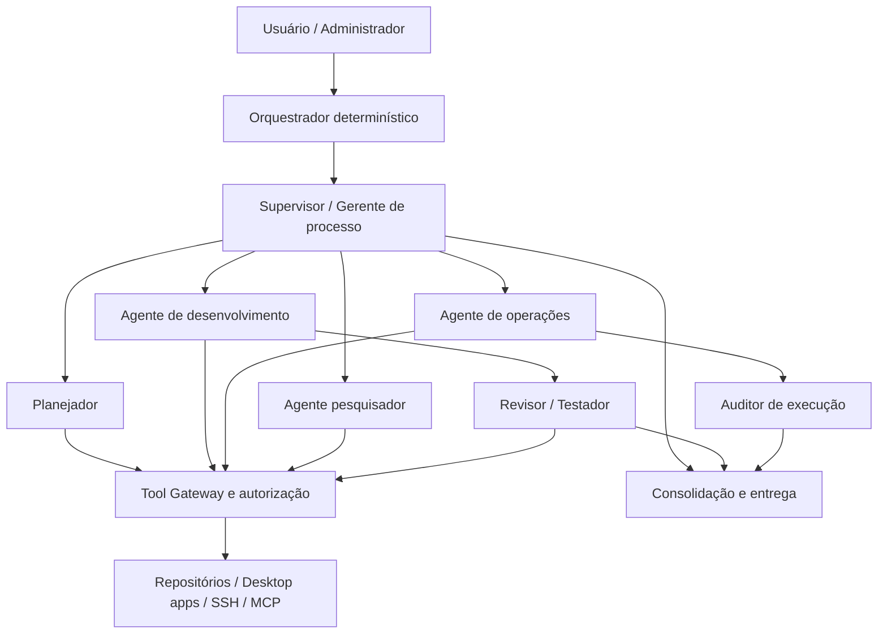

# 10 · Hierarquia de agentes, processos e delegação

> [← Mapa Mestre](../README.md) · [↑ Arquiteturas](README.md) · [Objetivo](../00-fundamentos/05-proposito-e-casos-de-uso.md) · [Permissões](11-acesso-maquina-e-isolamento.md)

## Organograma operacional



A hierarquia é **um grafo dirigido de tarefas**, não acesso de administrador por ser "supervisor". O plano descreve dependências, entradas, outputs, critérios de aceite, orçamentos e riscos. O executor nunca recebe as credenciais completas de seu supervisor.

## Entidades

- `Agent`: ID, nome, descrição, papel, provider, model, supervisor_id, estado, prompt de função, permissões próprias.
- `Team`: membros, supervisor, projetos, orçamento agregado, regras de escalonamento.
- `Workflow`: objetivo, tarefas, grafo de dependências, triggers manuais/agendados, limites e output esperado.
- `Task`: agent_id, workspace, dependências, instruções, artefatos, deadline, política de aprovação, idempotência e status.
- `PermissionGrant`: resource_id, action, scope, expiration, approved_by, approval_mode, max_calls.
- `ToolInvocation`: ferramenta, argumentos validados, principal executor, consentimento, resultado, custo/erro.
- `Artifact`: patch, arquivo, relatório, links de PR, diff, logs sanitizados e metadados de proveniência.

## Ciclo da tarefa

1. Receber objetivo e escolher equipe, provedor e limite.
2. Planejar um DAG com etapas e dependências; validar nomes de agente e recursos existentes.
3. Agendar tarefas habilitadas conforme concorrência/custo.
4. Resolver permissões efetivas de cada agente para a operação: **interseção entre política do sistema, autorização do usuário, permissão do supervisor e permissão específica do agente**.
5. Executar ação de ferramenta via gateway, usando principal de baixa permissão e logs.
6. Produzir artefatos; validar saída por JSON Schema, testes reais e/ou revisão contextual.
7. Pedir aprovação humana somente onde a política exige (edição crítica, deploy, push, admin, etc.).
8. Consolidar resultado e finalizar ou replanejar dentro dos limites.

## Regra de delegação

Um gerente pode delegar **subconjuntos** do próprio escopo, nunca criar permissão superior. Exemplo: gerente possui leitura de repositório e permissão de editar branch `feature/*`; pode conceder a um coder apenas leitura+edição da branch de trabalho, não acesso a outros repositórios, branch principal ou máquina inteira. Perfis de tarefas **não** alteram ACL do sistema operacional diretamente.

## Autonomia por grau

| Grau | Comportamento | Aplicação |
|---|---|---|
| `observe` | lê recursos autorizados e prepara plano | padrão para novos conectores |
| `draft` | cria patch, branch isolada ou arquivo temporário | codificação sem aplicar mudanças sensíveis |
| `execute_scoped` | grava apenas em workspace/ferramentas autorizados; registra auditoria | tarefas repetitivas e testes |
| `approval_required` | apresenta diff, destino e impacto antes de executar | push, merge, deploy, alteração de contas, instalação |
| `privileged_session` | operação elevada via broker com escopo/prazo definidos | manutenção do SO a pedido do usuário |

Elevação **não** significa que o processo LLM ganha `sudo` ou Administrator sem restrições. Os modos são perfis de política que podem ser ajustados por recurso, função e usuário.

## Concorrência, orçamento e falhas

- `max_steps`, `max_parallel_agents`, `max_tool_calls`, `max_cost_usd`, timeout e limites de rede.
- Fila/DAG executa tarefas paralelas apenas sem conflito de arquivos ou dependências.
- Ações com side effects usam chaves de idempotência e verificação de estado antes de retry.
- Em falhas de modelo não escalar automaticamente permissões nem alterar provider sem política do usuário.
- Logs mostram quem solicitou, quem aprovou, qual agente executou, quais arquivos foram afetados, hash/commit e gastos.

## Exemplo de fluxo de programação

```text
Pedido: "corrigir autenticação no repo X"
  Supervisor (DeepSeek Pro)
    ├── Analyzer (DeepSeek Flash): lê requisitos e faz inventário
    ├── Coder (Grok Build): altera worktree isolada
    ├── Tester (DeepSeek Flash): executa suíte autorizada
    └── Reviewer (Grok reasoning): revisa diff + testes
  Human gate: aprovar commit/push/PR
  Entregável: diff + branch + resultado dos testes + custo
```

Provedores ilustrativos, não benchmark. O agente testador não recebe automaticamente `ssh`, cofre inteiro ou permissão de push.

**Relacionados:** [Objetivo e casos de uso](../00-fundamentos/05-proposito-e-casos-de-uso.md) · [Recursos de máquina e permissões](11-acesso-maquina-e-isolamento.md) · [Git](../05-integracoes/01-git-repositorios-ssh.md) · [Configurações](08-configuracao-e-perfis.md).
