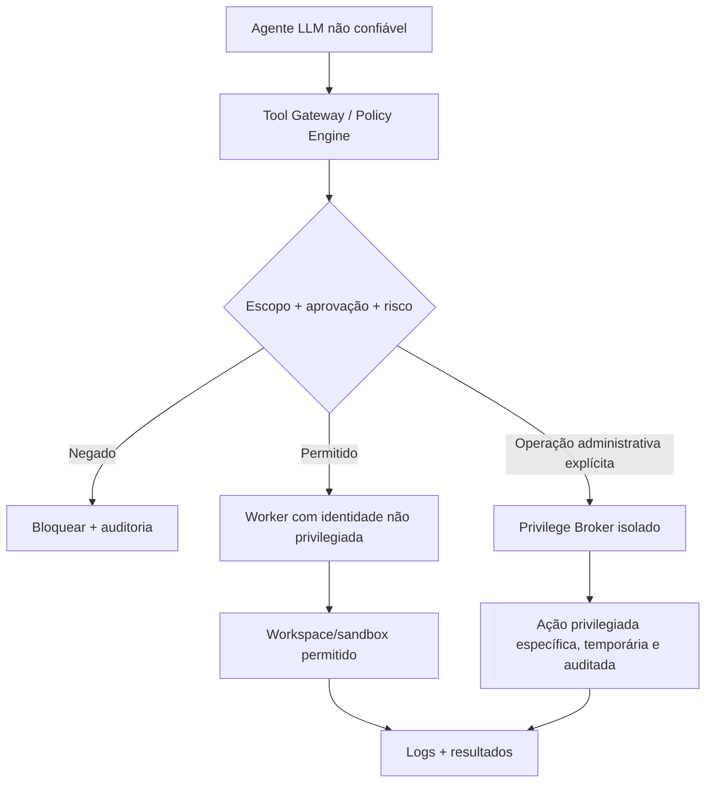

# 11 · Acesso ao PC/servidor, execução local, GUI e elevação de privilégios

> [← Mapa Mestre](../README.md) · [↑ Arquiteturas](README.md) · [Hierarquia](10-hierarquia-processos-e-politicas.md) · [Integrações Git/SSH](../05-integracoes/01-git-repositorios-ssh.md)

## O requisito real

O usuário deseja que agentes possam **usar o computador como ferramentas de trabalho reais**: ler/editar arquivos, controlar aplicativos de interface gráfica, executar comandos e testes, interagir com repositórios, instalar extensões e operar hosts remotos por SSH, **quando autorizados**. O MultAgent deve disponibilizar as APIs, adaptadores e segurança para isso em Windows 10/11 e Linux Desktop; Server executa operações headless.

**A capacidade de acesso amplo deve existir como opção**, mas executar continuamente o processo principal como root/Administrador criaria risco crítico: uma ferramenta defeituosa, plugin malicioso ou prompt injection poderia apagar arquivos, roubar credenciais ou comprometer todo o OS.

## Arquitetura de privilégio

### Instalação e primeira execução

- **Instalador Desktop** pode solicitar elevação para instalar componentes de sistema ou registrar serviço opcional; instalação por usuário é preferível quando suficiente.
- **Desktop GUI** inicia com privilégios normais, sem `sudo` nem "Executar como Administrador". A interface permite ao usuário autorizar **pastas e ferramentas específicas**.
- **Server** usa conta de serviço dedicada com privilégios mínimos; privilégios de instalação/configuração separados da conta runtime.
- **Broker privilegiado** só será instalado quando o usuário habilitar módulos que realmente o exijam. O executor manda requisições com operações allowlisted, validadas por ACL, prazo, sessão, usuário administrador e trilha de auditoria; broker não recebe prompts de IA, comandos livres ou tokens de modelo.
- Oferecer `admin session` opcional com autorização interativa e validade curta para ações administrativas; **não** transmitir credenciais de root/administrador ao LLM.

### Modelo de recursos e permissões

| Recurso | Permissão granular |
|---|---|
| Diretório local | `fs.read` / `fs.write` para caminho canônico aprovado, sem escaping por symlink |
| Workspace Git | `repo.read`, `repo.patch`, `repo.commit`, `repo.push` com repo/branch permitidos |
| Comando | `process.run` para executável/args/cwd previstos, com timeout/limites |
| Aplicativo GUI | `desktop.observe`, `desktop.control` com app/janela permitidos e sessão gráfica |
| Host SSH | `ssh.connect`, `ssh.read`, `ssh.exec_scoped` para host/conta/comando aprovados |
| MCP/Plugin | `extension.connect`, `extension.tool.invoke` por namespace/ferramenta |
| Sistema | `os.privileged.request`, somente broker com aprovação separada |

Permissão do usuário **não substitui controle do OS**; isole workers e ambientes. Combine allowlist de caminhos com sandbox de processos/containers/VM se precisar garantir que scripts de terceiro não saiam do workspace. **Caminho canônico sozinho não contém um comando shell arbitrário**. Evitar tratar qualquer string originada do LLM como comando de sistema.

## Automação de programas locais

- Windows Desktop: adaptadores usando UI Automation/controles acessíveis (por exemplo, `pywinauto` quando compatível) e interação mouse/teclado em última instância.
- Linux Desktop: adaptadores apoiados em AT-SPI/acessibilidade e protocolos de captura/interação compatíveis com Wayland/X11; restrições variam por ambiente e políticas.
- Prioridade: API oficial do app → plugin/MCP confiável → acessibilidade/UI Automation → automação por coordenadas (frágil, confirmada e monitorada).
- GUI automation geralmente depende da **sessão gráfica desbloqueada**. Não prometer controle de aplicativos GUI no Ubuntu Server headless ou Windows Server sem sessão interativa; preferir APIs/CLI na edição Server.
- Permissão por aplicativo/janela e usuário presente; registrar ações/resultado sem capturar dados sensíveis desnecessários.

## Operações destrutivas e acessos perigosos

Exigir prévia e confirmação em ações como excluir diretórios, editar configurações do SO, alterar política de firewall, elevar privilégios, publicar repositórios, fazer deploy, acessar SSH em produção ou instalar plugin executável. Requerer approver humano local/administrador do tenant, confirmar o **impacto concreto** e permitir revogar/cancelar. Suporte a execução automática **somente quando política expressa autorizar exatamente aquele recurso, tipo de ação, janela de tempo e limite**.

## Segurança e ameaças

1. Prompt injection em README/website/issue/MCP é tratado como **conteúdo**, não ordem a executar.
2. Não copiar variáveis de ambiente, credenciais SSH, vault ou filesystem não autorizado para modelos remotos.
3. Plugins e skills de terceiros são potencialmente executáveis e não confiáveis. Instalar em quarentena/sandbox, verificar versão, origem e dependências; nunca executar `postinstall` arbitrário na sessão privilegiada.
4. Acompanhar modificações em arquivos via diff/checkpoints e restaurar sem apagar dados de usuário.
5. Rejeitar escalonamento indireto: "agente filho" não pode criar uma função que ignore a policy engine.
6. Logs de auditoria imutáveis ou protegidos; alerta de uso anormal, botão de parada e revogação de grants.

## Ordem para implementar

1. Filesystem somente leitura por diretório com API tipada e unit tests.
2. Worktree Git isolada para edição e testes não privilegiados.
3. Tool Gateway com grants + aprovação e integração SSH de baixa permissão.
4. Adapters GUI por SO (somente Desktop), e testes em sessão gráfica real.
5. Plugin/MCP sandbox, catálogo com revisão de permissões.
6. Broker privilegiado por OS, **por último**, com revisão de segurança e testes adversariais.

**Referências:** [Objetivo](../00-fundamentos/05-proposito-e-casos-de-uso.md), [Git e SSH](../05-integracoes/01-git-repositorios-ssh.md), [Catálogo de extensões](../05-integracoes/02-catalogo-mcp-plugins-skills.md), [Mapa mestre](../README.md).
