# 03 · Organização do código, GitHub Releases e CI/CD

> [← Mapa Mestre](../README.md) · [↑ Distribuição](README.md) · [Instalação](01-instalacao-cli.md) · [Governança](02-licenca-e-contribuicoes.md)

## Layout de diretórios já versionado (apenas Markdown)

A estrutura técnica agora está fisicamente criada no GitHub, com um `README.md` em **cada pasta**. O organograma detalhado e clicável está em **[06 · Mapa físico de diretórios](../06-desenvolvimento/01-mapa-de-pastas.md)**.

| Caminho real | Função planejada |
|---|---|
| [src/multagent/](../../src/multagent/README.md) | Motor Python, agentes, modelos, tools, segurança, storage, Desktop/Server e CLI |
| [frontend-server/](../../frontend-server/README.md) | React/TypeScript **somente edição Server** |
| [scripts/](../../scripts/README.md) | Instaladores Windows/Linux e releases futuros |
| [tests/](../../tests/README.md) | Unitários, integração, E2E, segurança e smoke tests por SO |
| [config/](../../config/README.md) | Schemas e templates sem segredos |
| [examples/](../../examples/README.md) | Perfis e workflows documentais |
| [assets/](../../assets/README.md) | Marca, ícones e materiais visuais futuros |
| [.github/](../../.github/README.md) | Documentação para CI, PRs e templates |

**Ainda não existem** `pyproject.toml`, código `.py`, fonte `.tsx`, `package.json`, `install.sh`, `install.ps1`, workflows YAML ou binários. Esses arquivos só serão adicionados quando sua implementação for autorizada e testada. Não confundir diretório presente com recurso funcional.

## Fluxo de contribuição e publicação

```mermaid
flowchart LR
 DEV["Fork ou branch"] --> PR["Pull Request público"]
 PR --> CI["Lint + testes + SAST + build"]
 CI --> REVIEW["Revisão e aprovações"]
 REVIEW --> MERGE["main protegida"]
 MERGE --> TAG["Tag vX.Y.Z + changelog"]
 TAG --> BUILD["Windows/Linux build matrices"]
 BUILD --> SIG["Checksums + attestations"]
 SIG --> REL["GitHub Release pública"]
 REL --> INST["Installers por OS"]
```

## Contrato de distribuição de releases

- Tags versionadas (`v0.1.0`, `v0.1.1`, ...) apontam para **commits públicos**.
- Uma release contém código correspondente, notas, binários para cada sistema suportado e arquivos de verificação.
- **Dois artefatos por sistema-alvo:** `multagent-desktop-v0.1.0-windows-x86_64.zip`, `multagent-server-v0.1.0-windows-x86_64.zip`, `multagent-desktop-v0.1.0-linux-x86_64.tar.gz` e `multagent-server-v0.1.0-linux-x86_64.tar.gz` (nomes de referência; incluir outras arquiteturas apenas após CI/testes).
- Um manifesto `SHA256SUMS` fornece digests, mas precisa ter **origem autenticada** para proteger contra substituição do próprio manifesto; preferir attestations/assinaturas de release do GitHub e publicar checks adicionais.
- Instalação por usuário sem privilégio admin/root na via padrão.
- O `multagent update` resolve o release oficial do canal selecionado (`stable`/`beta`), valida versão e integridade, mantém dados/configurações e dá rollback quando viável.
- Atualização nunca deve exportar as chaves do usuário nem substituir SQLite sem backup e migração testada.

## Proteção de supply chain

GitHub descreve [verificação de integridade de releases](https://docs.github.com/en/code-security/how-tos/secure-your-supply-chain/secure-your-dependencies/verify-release-integrity); GitHub CLI suporta `gh release verify` e `gh release verify-asset` para releases suportadas. Essa validação pode ser incorporada ao instalador ou acompanhada de mecanismo equivalente; não exija `gh` obrigatoriamente no PC do usuário comum.

[Documentação oficial: release verify](https://cli.github.com/manual/gh_release_verify) · [Download de releases](https://cli.github.com/manual/gh_release_download).

## Build reproduzível e documentação

A matriz de CI deve:
- testar o **motor Python compartilhado**, banco/migrações, modelos e policy router;
- testar **PySide6 GUI Desktop** e empacotar Qt sem FastAPI/React obrigatório;
- testar FastAPI/HTTP e frontend **React exclusivo do Server**;
- empacotar Desktop e Server **separadamente**, sempre a partir da mesma tag;
- executar smoke tests Desktop em Windows 10/11 e Ubuntu/Debian com GUI, e Server em Linux/Windows headless, inclusive máquinas sem Python;
- bloquear release se um artefato ou checksum não bater;
- manter README e índice `org/` atualizados quando a CLI mudar;
- testar GUI Desktop offline sem abertura de porta; testar HTTP Server autenticado, bind/porta/TLS e comportamento sem Internet;
- permitir que qualquer interessado reconstrua o pacote a partir do código e das dependências declaradas.

## Diferença entre código open-source e componentes externos

A aplicação funciona com chave da API do **próprio usuário**, e o usuário paga seu consumo do provedor. Não há serviço intermediário obrigatório do mantenedor; caso seja criado SaaS adicional, ele deverá ser documentado separadamente. **Nenhuma credencial pessoal pertence a uma release ou ao repositório.**

## Decisões pendentes

1. Escolher licença final e adicioná-la corretamente ao código e releases.
2. Definir versões de Windows e distribuições/arquiteturas Linux suportadas.
3. Selecionar ferramenta de empacotamento binário e validar seu suporte ao target.
4. Projetar vault multiplataforma e modo Linux headless.
5. Decidir se `--background` será entregue no primeiro MVP.
6. Definir política de atualização automática (padrão sugerido: **verificar**, mas não atualizar sem consentimento).

**Releases Desktop e Server:** [Contratos das duas edições](04-edicoes-desktop-server.md). O binário Desktop deve usar `pyside6-deploy`/Nuitka ou equivalente validado; Server não inclui Qt. Licenças dos componentes Qt devem acompanhar a distribuição conforme aplicável.

**Relacionado:** [Mapa mestre](../README.md) · [Arquitetura](../02-arquiteturas/README.md) · [Roadmap](../02-arquiteturas/07-plano-de-implementacao.md).
