# 03 · Organização do código, GitHub Releases e CI/CD

> [← Mapa Mestre](../README.md) · [↑ Distribuição](README.md) · [Instalação](01-instalacao-cli.md) · [Governança](02-licenca-e-contribuicoes.md)

## Layout proposto para a implementação

```text
MultAgent/
├── README.md                    # link para o mapa mestre
├── org/                         # documentação estruturada já existente
│   ├── README.md
│   ├── 00-fundamentos/
│   ├── 01-provedores/
│   ├── 02-arquiteturas/
│   ├── 03-trilhas/
│   └── 04-distribuicao/
├── src/multagent/               # código do produto Python
│   ├── __main__.py              # python -m multagent (desenvolvimento)
│   ├── cli.py                   # start, status, update, doctor
│   ├── api/                     # FastAPI, static SPA, autenticação local
│   ├── core/                    # orquestrador, workflow, router e execução
│   ├── providers/               # adapters DeepSeek e Grok
│   ├── agents/                  # agentes e perfis
│   ├── tools/                   # tool gateway, MCP local
│   ├── storage/                 # SQLite, migrações
│   └── security/                # vault e controle de acesso
├── frontend/                    # React + TypeScript/Vite (proposta)
│   ├── src/
│   └── package.json
├── scripts/
│   ├── install.sh               # FUTURO: instalação Linux
│   └── install.ps1              # FUTURO: instalação Windows
├── tests/
├── .github/workflows/           # FUTURO: checks e builds
├── pyproject.toml               # FUTURO: pacote e entrypoint multagent
├── uv.lock                      # FUTURO: lockfile reprodutível
├── LICENSE                      # PENDENTE: definição pelo titular
└── .gitignore
```

**Importante:** os caminhos de código são **somente um projeto de estrutura**; ainda não estão criados como arquivos executáveis.

## Fluxo de contribuição e publicação

```mermaid
flowchart LR
 DEV["Fork ou branch"] --> PR["Pull Request público"]
 PR --> CI["Lint + testes + SAST + build"]
 CI --> REVIEW["Revisão e aprovações"]
 REVIEW --> MERGE["main protegida"]
 MERGE --> TAG["Tag vX.Y.Z + changelog"]
 TAG --> BUILD["Windows/Linux build matrices"]
 BUILD --> SIG["Checksums + attestations"]
 SIG --> REL["GitHub Release pública"]
 REL --> INST["Installers por OS"]
```



## Contrato de distribuição de releases

- Tags versionadas (`v0.1.0`, `v0.1.1`, ...) apontam para **commits públicos**.
- Uma release contém código correspondente, notas, binários para cada sistema suportado e arquivos de verificação.
- Nomes sugeridos: `multagent-v0.1.0-windows-x86_64.zip`, `multagent-v0.1.0-linux-x86_64.tar.gz`, `multagent-v0.1.0-linux-aarch64.tar.gz`; mais arquiteturas só após CI e testes.
- Um manifesto `SHA256SUMS` fornece digests, mas precisa ter **origem autenticada** para proteger contra substituição do próprio manifesto; preferir attestations/assinaturas de release do GitHub e publicar checks adicionais.
- Instalação por usuário sem privilégio admin/root na via padrão.
- O `multagent update` resolve o release oficial do canal selecionado (`stable`/`beta`), valida versão e integridade, mantém dados/configurações e dá rollback quando viável.
- Atualização nunca deve exportar as chaves do usuário nem substituir SQLite sem backup e migração testada.

## Proteção de supply chain

GitHub descreve [verificação de integridade de releases](https://docs.github.com/en/code-security/how-tos/secure-your-supply-chain/secure-your-dependencies/verify-release-integrity); GitHub CLI suporta `gh release verify` e `gh release verify-asset` para releases suportadas. Essa validação pode ser incorporada ao instalador ou acompanhada de mecanismo equivalente; não exija `gh` obrigatoriamente no PC do usuário comum.

[Documentação oficial: release verify](https://cli.github.com/manual/gh_release_verify) · [Download de releases](https://cli.github.com/manual/gh_release_download).

## Build reproduzível e documentação

A matriz de CI deve:
- testar backend Python, API local, banco/migrações e policy router;
- testar frontend React e gerar build estático;
- empacotar frontend e backend da **mesma tag**;
- executar smoke tests em Windows e Linux, inclusive máquina sem Python;
- bloquear release se um artefato ou checksum não bater;
- manter README e índice `org/` atualizados quando a CLI mudar;
- testar funcionamento offline do painel e tratamento de ausência de Internet;
- permitir que qualquer interessado reconstrua o pacote a partir do código e das dependências declaradas.

## Diferença entre código open-source e componentes externos

A aplicação funciona com chave da API do **próprio usuário**, e o usuário paga seu consumo do provedor. Não há serviço intermediário obrigatório do mantenedor; caso seja criado SaaS adicional, ele deverá ser documentado separadamente. **Nenhuma credencial pessoal pertence a uma release ou ao repositório.**

## Decisões pendentes

1. Escolher licença final e adicioná-la corretamente ao código e releases.
2. Definir versões de Windows e distribuições/arquiteturas Linux suportadas.
3. Selecionar ferramenta de empacotamento binário e validar seu suporte ao target.
4. Projetar vault multiplataforma e modo Linux headless.
5. Decidir se `--background` será entregue no primeiro MVP.
6. Definir política de atualização automática (padrão sugerido: **verificar**, mas não atualizar sem consentimento).

**Relacionado:** [Mapa mestre](../README.md) · [Arquitetura](../02-arquiteturas/README.md) · [Roadmap](../02-arquiteturas/07-plano-de-implementacao.md).
