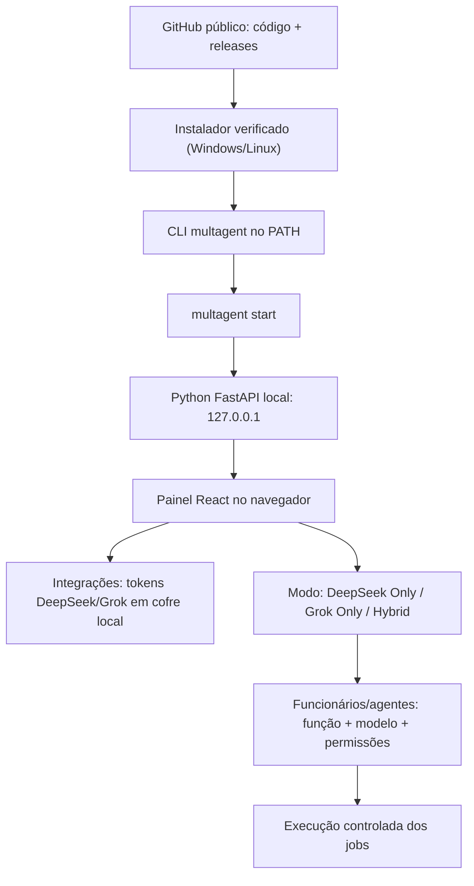

# 04 · Distribuição, instalação e governança open-source

> [← Mapa Mestre](../README.md) · [↑ Arquiteturas](../02-arquiteturas/README.md) · [Roadmap](../02-arquiteturas/07-plano-de-implementacao.md)

## Decisão arquitetural — MultAgent instalável pelo terminal

**O MultAgent será um projeto público no GitHub, distribuído para Windows e Linux.** O usuário deverá conseguir **instalar com um comando no terminal** e, após isso, **iniciar o serviço por um comando curto**, podendo criar seu próprio atalho. O objetivo é um produto local e open-source, sem exigir um instalador gráfico, conta central obrigatória ou Docker como dependência de usuários finais.

**Stack definida para planejamento:** Python 3.12+ (CLI, FastAPI e orquestração dos agentes), React + TypeScript (painel web servido localmente), SQLite (configurações e jobs) e armazenamento seguro de credenciais por sistema operacional. **Tauri não é obrigatório** e fica fora do MVP. Frontend e backend serão distribuídos na mesma release; o usuário abre o painel no navegador do próprio computador.

**Status:** especificação, não implementação. **Os comandos e URLs de instalação ainda não estão publicados**; não os execute até existirem releases verificadas.

## O que ler nesta seção

1. **[01 — Instalação, execução, atualização e atalhos](01-instalacao-cli.md)**: experiência no Windows/Linux, processos, binários, serviços opcionais e segurança da distribuição.
2. **[02 — Licenças open-source e regras de publicação](02-licenca-e-contribuicoes.md)**: AGPLv3 x GPLv3, o que pode ser exigido legalmente, PRs e atribuição.
3. **[03 — CI/CD, releases e layout de repositório](03-releases-e-estrutura.md)**: build por SO/arquitetura, verificações e política de atualização.

## Fluxo do usuário final (planejado)



O programa não precisará de Python nem Node instalados pelo usuário **no caminho de releases autossuficientes**; contribuidores poderão optar por desenvolver com Python/Node localmente.

## Comandos previstos para o CLI (ainda indisponíveis)

```text
multagent --version       # mostrar versão e origem da build
multagent start           # executar no primeiro plano; Ctrl+C encerra
multagent start --open    # iniciar e abrir o navegador
multagent start --background   # opcional; daemon/serviço gerenciado
multagent stop            # encerrar instância iniciada em background
multagent status          # consultar disponibilidade local
multagent update          # baixar nova release verificada após confirmação
multagent doctor          # diagnosticar instalação, permissões e conectividade
```

## Decisões e limites

- O serviço vincula-se inicialmente **somente a 127.0.0.1**. Acesso remoto/LAN será outro recurso, com autenticação e opt-in.
- O usuário cadastra DeepSeek e/ou Grok, depois define o modo global. Cada funcionário recebe um provedor e modelo próprios, sempre dentro das permissões globais.
- Chaves e segredos **não** serão guardados em texto puro no SQLite e **não** irão ao GitHub.
- Todo **código aceito no repositório oficial** deve ser público e versionado; alterações privadas de terceiros **não** podem ser universalmente obrigadas a aparecer em GitHub por licenças open-source convencionais.
- A escolha final da licença (AGPLv3 recomendada para avaliação) requer decisão explícita antes de adicionar o arquivo legal `LICENSE`.

**Relacionamentos:** [Arquiteturas](../02-arquiteturas/README.md) · [Configuração de agentes](../02-arquiteturas/08-configuracao-e-perfis.md) · [Mapa mestre](../README.md).
