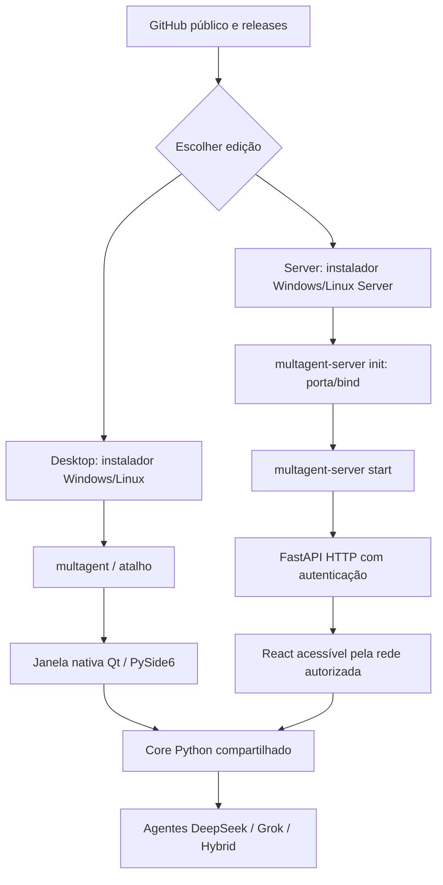

# 04 · Distribuição: executáveis Desktop e Server, instalação e open-source

> [← Mapa Mestre](../README.md) · [↑ Arquiteturas](../02-arquiteturas/README.md) · [Roadmap](../02-arquiteturas/07-plano-de-implementacao.md)

## Decisão do produto

**MultAgent Desktop** será um **executável com interface gráfica nativa** para Windows 10/11, Ubuntu e Debian Desktop. O comando planejado `multagent` abrirá a janela PySide6/Qt diretamente, sem usar navegador, React, WebView ou qualquer listener HTTP.

**MultAgent Server** será uma **distribuição executável headless** para Windows Server, Ubuntu Server e Debian Server. A configuração inicial coletará a porta e o endereço de bind. Somente a edição Server inicializa FastAPI e disponibiliza seu **painel React/TypeScript por HTTP**, com autenticação/TLS conforme exposição da rede.

Ambas compartilham o **motor Python** (DeepSeek/Grok, orquestrador, funcionários/agentes, MCP, tarefas, banco e custos). A instalação ocorre via scripts oficiais de GitHub Releases, mas **ainda não existem scripts, binários ou aplicativos publicados**. O trabalho desta fase é especificação arquitetural.

## Sumário navegável

1. **[Instalar e executar: Windows/Linux Desktop e Server](01-instalacao-cli.md)** — comandos, atalhos, porta apenas Server, atualização e logs.
2. **[Licença e contribuições públicas](02-licenca-e-contribuicoes.md)** — AGPLv3 em avaliação, alterações distribuídas versus privadas, PRs e regras de contribuição.
3. **[Releases, builds e organização do código](03-releases-e-estrutura.md)** — pipelines por SO/arquitetura e por edição, artefatos verificáveis.
4. **[O que muda entre Desktop e Server](04-edicoes-desktop-server.md)** — tabela de capacidades e responsabilidades técnicas.
5. **[Núcleo Python compartilhado e duas interfaces](../02-arquiteturas/09-desktop-server-core-compartilhado.md)** — contratos, persistência, GUI Qt e API Server.

## Fluxos do usuário

No **Desktop, terminal é apenas um meio de instalação, inicialização e diagnóstico**, não a interface principal. O programa pode iniciar por atalho sem console. No **Server, a CLI gerencia configuração e processo**, e a administração remota é feita por painel web.

## Segurança e decisões pendentes

- Cada instalação terá armazenamento próprio de credenciais; jamais registrar chaves da API em logs, YAML público ou GitHub.
- Porta configurável somente para **Server**. Instalação não deve abrir firewall ou usar `0.0.0.0` silenciosamente. Acesso remoto exige identidade, permissões e TLS.
- **Core Python único** — alterações no orquestrador valem para as duas edições, sem reimplementar agentes.
- Binários e bundles por plataforma devem passar por CI e testes; builds Desktop empacotam Qt, Server não depende de Qt.
- Seleção final de licença **ainda pendente**. PySide6 é LGPLv3/GPLv3/comercial; observar licenças dos módulos antes de redistribuir.

**Navegação:** [Mapa mestre](../README.md) · [Arquitetura](../02-arquiteturas/README.md) · [Instaladores](01-instalacao-cli.md).
