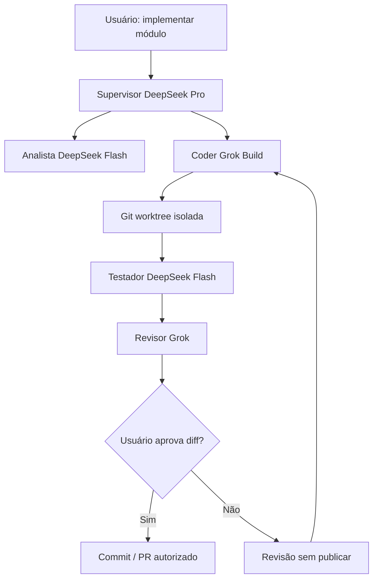

# 04 · Exemplos de workflows, equipes de IA e integrações reais

> [← Mapa Mestre](../README.md) · [↑ Integrações](README.md) · [Hierarquia de agentes](../02-arquiteturas/10-hierarquia-processos-e-politicas.md)

## Cenário 1 — Equipe de desenvolvimento autônoma em repositório local

**Configuração:** repositório `/home/user/projetos/erp` ou `C:\Projetos\ERP`; supervisor com leitura; coder com escrita em worktree `feature/*`; tester com permissão para executar conjunto aprovado de testes em sandbox; reviewer com leitura do diff.

**Entregáveis:** proposta de mudança, diff, relatórios de testes, link para PR se autorização explicitamente concedida. **Nunca publicar em branch principal como default.**

## Cenário 2 — Projeto GitHub, GitLab ou Bitbucket remoto

O usuário instala conector, faz OAuth quando compatível, escolhe repositório específico e restringe tipo de permissão. Agente de análise consulta issues/commits, coder modifica branch local, QA testa e supervisor pede autorização para push/PR. Chaves nunca entram no contexto do modelo.

## Cenário 3 — Manutenção por SSH

O usuário cadastra host SSH identificado e conhecido, usuário remoto sem root e paths permitidos. Planner gera plano e propõe comandos de diagnóstico. Agente lê logs autorizados; reparo com impacto ou `sudo` exige **aprovação separada e broker/escopo**; retorno inclui mudanças, logs e rollback onde cabível. No Server, tudo funciona headless sem GUI gráfica.

## Cenário 4 — Operação de aplicativo Desktop

Em Windows 11 ou Ubuntu Desktop, usuário concede ao agente acesso a um aplicativo específico. O agente usa API do app quando houver; caso contrário, um adaptador de acessibilidade da GUI para ler/preencher campos suportados. Emissões de e-mail, cliques destrutivos, alterações de arquivo ou compras seguem regras de confirmação. UI automation pode depender de sessão desbloqueada e não é garantida em todo aplicativo/Wayland.

## Cenário 5 — Catálogo MCP e plugins

Usuário pesquisa um MCP público para um sistema de gestão, consulta seu manifesto e permissões, vincula OAuth e habilita **somente ferramenta de leitura** para "Analista". Para autorizar ferramenta de alteração, amplia grant com confirmação. Integrador não ganha acesso automático a shell/rede inteira do computador.

## Agendamento e execução contínua

Workflows podem começar manualmente ou por agenda/trigger autorizado, com duração máxima, orçamento, janelas de horário, taxa de consulta e mecanismos de parada. Desktop só pode controlar UI na sessão gráfica disponível; Server executa apenas ferramentas headless. Tarefas periódicas privilegiadas exigem limites particularmente rigorosos e não rodam como root permanente.

## Checklist por workflow

- [ ] Objetivo, entradas, recursos, donos e produtos finais definidos.
- [ ] Agentes/LLMs escolhidos com custo e limites.
- [ ] Arquivos/repos/hosts/aplicativos definidos em whitelist.
- [ ] Ações destrutivas/escrita/publicação identificadas e aprovadas.
- [ ] Conectores confiáveis, versões fixadas e tokens protegidos.
- [ ] Plano de teste, rastreabilidade, falha/cancelamento e possível rollback.
- [ ] Usuário consegue rever logs, custos e diffs de saída.

**Relacionado:** [Missão](../00-fundamentos/05-proposito-e-casos-de-uso.md) · [Roadmap de construção](05-caminho-de-implementacao.md) · [Segurança](../02-arquiteturas/11-acesso-maquina-e-isolamento.md).
