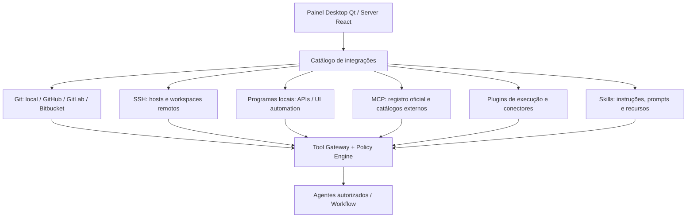

# 05 · Integrações, workspaces, repositórios, MCPs, plugins e skills

> [← Mapa Mestre](../README.md) · [Objetivo do projeto](../00-fundamentos/05-proposito-e-casos-de-uso.md) · [Acesso ao PC](../02-arquiteturas/11-acesso-maquina-e-isolamento.md)

## Objetivo

Permitir que o usuário **instale e autorize capacidades que cada funcionário de IA poderá usar**: repositórios locais/remotos, máquinas por SSH, aplicações do computador, ferramentas MCP, plugins e skills. É um **catálogo pesquisável na Internet, integrado ao painel**, com instalação guiada, autenticação OAuth quando fornecida pelo serviço e controles por agente, recurso e ação.

O catálogo será semelhante a uma central de integrações, mas **nunca** permitirá que um simples item público execute código automaticamente como Administrador ou root.

## Mapa de integrações

## Trilhas de documentação

1. **[Conexões Git, repositórios locais/remotos e SSH](01-git-repositorios-ssh.md)** — autenticação, worktrees, commits, branches, PRs e hosts.
2. **[Catálogo público MCP, plugins e skills](02-catalogo-mcp-plugins-skills.md)** — fontes, manifesto, instalação guiada e confiança.
3. **[OAuth, tokens, vault e autorização](03-oauth-tokens-seguranca.md)** — identidade, escopos, revogação e práticas de segurança.
4. **[Fluxos de agentes e projetos práticos](04-workflows-e-exemplos.md)** — hierarquia de trabalhos, execução local/SSH/apps.
5. **[Roadmap objetivo → MVP → autonomia](05-caminho-de-implementacao.md)** — entregas e critérios de aceite.

## Telas planejadas

| Aba | Ações do usuário |
|---|---|
| Integrações | procurar, instalar/configurar, vincular OAuth, conceder escopos, remover |
| Recursos | aprovar diretórios locais, repositórios Git, hosts SSH e apps específicos |
| Funcionários | vincular integrações a agentes; selecionar IA, função, autonomia, orçamento |
| Processos | criar workflow hierárquico, dependências, gatilhos e entregáveis |
| Execuções | acompanhar operações, histórico, logs, custos, aprovações, rollback |
| Segurança | revogar credenciais, desabilitar integração, ver permissões e auditoria |

As telas Desktop são **Qt nativas sem web app**; para login OAuth externo poderá ocorrer abertura **temporária do navegador do sistema** apenas para autenticar no serviço terceiro. A edição Server utiliza seu próprio painel React/HTTP.

## Inventário de fontes e modelo de confiança

- **MCP oficial:** https://registry.modelcontextprotocol.io/ — catálogo de descoberta, **não selo de segurança**.
- **GitHub:** https://github.com/ — repositórios públicos de plugins, skills ou servidores MCP, sujeitos a versão, licença e revisão.
- **Repositórios próprios:** GitLab, Bitbucket, URLs Git e outros registries configurados.
- **Manifestos locais:** caminho/URL fornecido pelo usuário, exigindo análise de permissões e código antes de ativar.
- **OAuth:** compatível com o serviço alvo, escopos necessários e método de autenticação implementado pelo provedor; **não é garantido por qualquer plugin**.

## Regra de confiança

Cada extensão terá `source`, `publisher`, `version`/commit fixado, `license`, `permissions`, `runtime`, `transport`, `auth`, `checksum`, `risk_level` e vínculo por agente. Usuário pode instalar em modo **desativado/quarentena**, rever manifesto e ativar apenas ferramentas permitidas.

**Próximo:** [Catálogo e instalação](02-catalogo-mcp-plugins-skills.md) · [Segurança de privilégios](../02-arquiteturas/11-acesso-maquina-e-isolamento.md).
