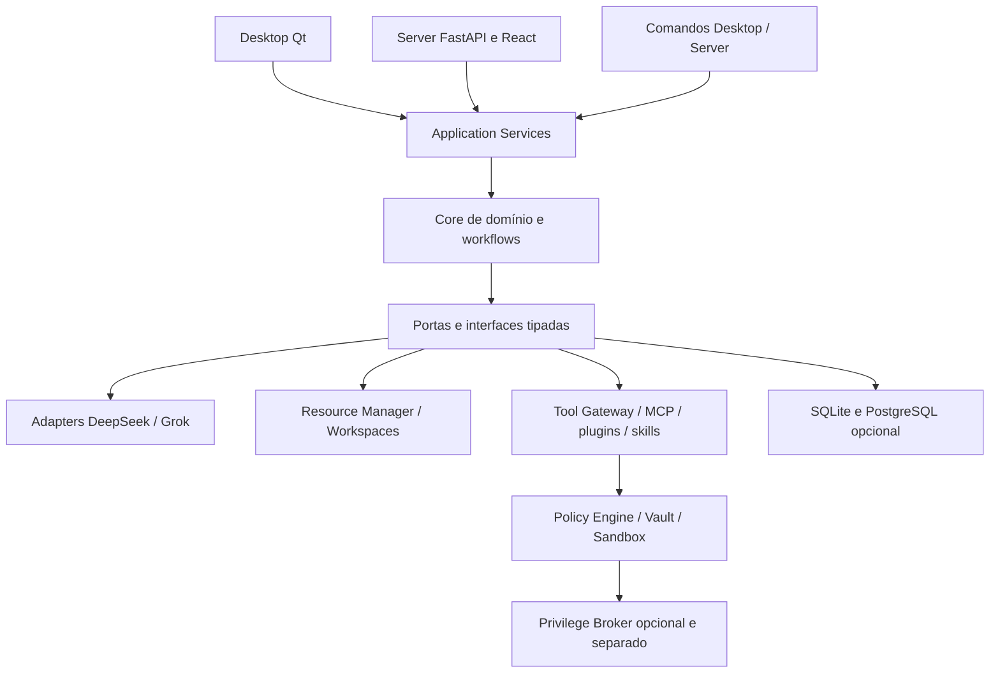

# 02 · Contratos, dependências e separação de responsabilidades

> [← Mapa Mestre](../README.md) · [↑ Desenvolvimento](README.md) · [Estrutura](01-mapa-de-pastas.md)

## Regra de desenho

O código de produção será implementado mais tarde. As pastas do repositório definem **fronteiras de responsabilidade** para evitar acoplamento. O Desktop usa **PySide6/Qt nativo**; Server usa **FastAPI + React** para acesso por rede. O `core` não importa frameworks de UI.

## Contratos por agregado

| Agregado | Definição esperada | Responsabilidade |
|---|---|---|
| Agent | ID, nome, papel, modelo, supervisor, autonomia | funcionário configurável |
| Team | membros, gerente, política e orçamento | organograma e delegação |
| Workflow/Task | DAG, recurso, entrada, saída, estado, limites | trabalhos hierárquicos |
| Run/Artifact | progresso, eventos, diffs, testes, custo | rastreabilidade |
| Workspace/Resource | repo/host/app/pasta e escopo | fonte de trabalho autorizada |
| PermissionGrant | identidade, recurso, ação, validade e aprovador | decisão de autorização |
| IntegrationInstance | origem, versão, conexão, scopes e vault ref | ligação a extensão externa |

## Fronteiras de segurança

1. **LLM é não confiável para autorizar ações.** Modelos sugerem tool calls, mas não decidem sua própria permissão.
2. **Tool Gateway aplica políticas** independentemente da interface Desktop/Server e do provedor.
3. **Processos e plugins de terceiros** exigem isolamento real; validar caminho não confina shell arbitrário.
4. **Broker privilegiado** isolado aceita apenas operações pré-definidas e consentidas, sem prompt livre ou sudo genérico.
5. **Credenciais** são guardadas em vault por SO/Server; modelos e frontend nunca recebem acesso ao armazenamento completo.
6. **Git e SSH** operam por workspaces/identidades de escopo mínimo e publicações sensíveis são revisáveis.

## Regras de dependência

- Permitido: Qt/Server/CLI → serviços de aplicação → interfaces/core → adapters.
- Proibido: core → Desktop, core → FastAPI, Core → UI, agentes → execução shell direto, plugin → banco de grants sem política.
- Desktop: zero listener HTTP para a interface; uma interação externa de OAuth pode usar navegador do SO/retorno temporário sem transformar o app em web.
- Server: cabeçalhos, autenticação, sessão, TLS, tenant e bind/porta só na edição Server.

**Referências:** [Arquitetura compartilhada](../02-arquiteturas/09-desktop-server-core-compartilhado.md) · [Acesso à máquina](../02-arquiteturas/11-acesso-maquina-e-isolamento.md).
