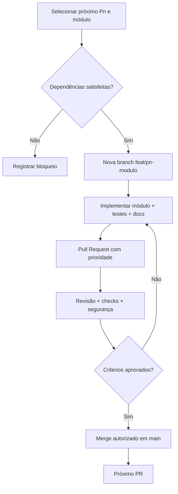

# 05 · Fluxo de PRs e prioridades P0 → P9

> [← Mapa Mestre](../README.md) · [↑ Desenvolvimento](README.md) · [CONTRIBUTING](../../CONTRIBUTING.md)

## Regra fundamental

**Todo módulo de código criado ou modificado no MultAgent oficial deve entrar por Pull Request.** Nada de desenvolver ou fazer push direto na `main`. Os módulos serão implementados segundo prioridades `P0`, `P1`, `P2`... e suas dependências. **Um PR por módulo ou incremento técnico coeso**; uma prioridade pode abranger vários PRs.

P0 representa a primeira prioridade. Prioridade não é o número do PR nem versão de release. A ordem pode ser refinada conforme o projeto evolui, sem dispensar revisão.

## Sequência de módulos

| Prioridade | Objetivo e módulos | Exemplos de PRs independentes |
|---|---|---|
| P0 | Fundamentos, pacote Python, contratos de domínio, testes e política de negação padrão | `build(P0/project)`, `feat(P0/core-domain)`, `test(P0/core)` |
| P1 | SQLite, migrações, vault, permissões por usuário/agente | `feat(P1/storage-sqlite)`, `feat(P1/security-vault)` |
| P2 | DeepSeek, Grok, catálogo de modelos, custos e router | `feat(P2/providers-deepseek)`, `feat(P2/providers-grok)` |
| P3 | Funcionários, equipes, hierarquia, processos, orquestrador | `feat(P3/agents)`, `feat(P3/orchestrator)` |
| P4 | Desktop nativo PySide6/Qt e telas do aplicativo | `feat(P4/desktop-shell)`, `feat(P4/desktop-agents)` |
| P5 | Server FastAPI, autenticação, workers e painel React | `feat(P5/server-api)`, `feat(P5/frontend-server)` |
| P6 | Repositórios Git locais, workspaces, patches, testes e diffs | `feat(P6/workspaces)`, `feat(P6/integrations-git)` |
| P7 | GitHub, GitLab, Bitbucket, OAuth e SSH | `feat(P7/github)`, `feat(P7/gitlab)`, `feat(P7/ssh)` |
| P8 | MCP, catálogo público de plugins/skills e isolamento | `feat(P8/mcp)`, `feat(P8/catalog)`, `feat(P8/plugins)` |
| P9 | Controle GUI avançado e broker de privilégios isolado | `feat(P9/desktop-automation)`, `security(P9/privilege-broker)` |

A CI básica deve ser introduzida cedo, idealmente em P0. Testes de build Windows/Linux acompanham as edições respectivas. Critérios de segurança acompanham todos os níveis, **não ficam adiados até P9**.

## Fluxo de desenvolvimento



## Requisitos por PR

1. Título `feat(P2/providers-grok): implementa adapter` ou equivalente, e branch `feat/p2-providers-grok`.
2. Escopo de **um módulo/incremento coeso**; objetivo, exclusões e dependências explícitos.
3. Código, testes adequados, documentação do módulo, logs de testes realmente realizados e plano de reversão.
4. Revisão obrigatória antes do merge; não confundir PR aberto com PR aprovado.
5. CI e análise de segurança conforme disponibilidade e risco. Nunca alegar testes não executados.
6. Proteção de segredos, isolamento de tools, menor privilégio e aprovação para operações críticas.
7. PR dependente espera por contrato/PR base; não marcar funcionalidades futuras como concluídas.

## Primeiros PRs sugeridos (ainda não criados)

```text
P0-01 build(P0/project): projeto Python e ferramentas de testes
P0-02 feat(P0/core-domain): schemas e entidades
P0-03 feat(P0/core-services): interfaces do domínio
P0-04 security(P0/permissions): deny-by-default
P0-05 test(P0/core): mocks e testes iniciais
```

## Regras técnicas do GitHub

A documentação estabelece a política, **mas não configura automaticamente branch protection**. É necessário configurar Ruleset de `main` exigindo PR, revisão/checks e restrição de push; labels `P0`, `P1` etc. ainda dependerão de configuração separada.

**Relacionados:** [CONTRIBUTING](../../CONTRIBUTING.md) · [Template de PR](../../.github/PULL_REQUEST_TEMPLATE.md) · [Roteiro de implementação](../05-integracoes/05-caminho-de-implementacao.md).
