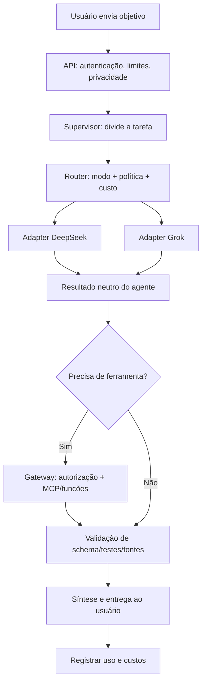

# MultAgent — Mapa Mestre de Conhecimento

> **Ponto de entrada único da documentação.** Aqui está a árvore completa para entender, planejar, desenvolver e operar o MultAgent. Os capítulos aprofundam cada assunto e oferecem links para voltar. Revisão: **18/10/2026**. Esta documentação descreve arquitetura e APIs; implementação depende de etapas futuras.

## 1. O que estamos construindo?

O **MultAgent** tem a missão de permitir que o usuário configure **múltiplos funcionários/agentes de IA**, com hierarquia de processos, equipes, ferramentas e permissões para realizar trabalhos reais: editar/testar código em Git local ou remoto, operar aplicativos, usar SSH e integrar MCPs, plugins e skills. O usuário controla o que cada agente pode acessar e autoriza ações críticas. [Propósito e exemplos](00-fundamentos/05-proposito-e-casos-de-uso.md).

O **MultAgent** é a proposta de uma plataforma pública no GitHub, instalável via terminal, com **duas edições**: **Desktop**, executável Python/PySide6 que abre uma janela gráfica real em Windows 10/11 e Ubuntu/Debian **sem navegador, React ou porta HTTP**, e **Server**, executável headless para Windows/Linux Server com FastAPI, porta configurável e painel React remoto. O núcleo Python de IA será compartilhado entre ambas. A plataforma executará vários **agentes especializados**, coordenados por um **orquestrador**, para decompor problemas, executar tarefas, usar ferramentas e validar resultados. [Detalhes da distribuição](04-distribuicao/README.md). Os comandos de instalação e execução ainda são requisitos a implementar. O projeto prevê três configurações independentes:

- **Somente DeepSeek:** todos os modelos de IA vêm da DeepSeek.
- **Somente Grok/xAI:** todos os modelos de IA vêm da xAI.
- **Híbrido DeepSeek + Grok:** o roteador seleciona o modelo adequado a cada etapa, respeitando custo, segurança e permissões.

O **agente** não é apenas um nome de modelo: é a união de um LLM, objetivos/instruções, contexto, memória controlada, permissões para ferramentas e um ciclo de execução supervisionado. O **multiagente** é a coordenação de vários desses papéis com comunicação mediada pelo sistema.

## 2. Como ler este mapa (a árvore completa)

```mermaid
flowchart TB
    ROOT["MultAgent — Mapa Mestre (org/README.md)"]
    ROOT --> F["00 · Fundamentos: IA, LLM e agentes"]
    ROOT --> P["01 · Provedores de modelos"]
    ROOT --> A["02 · Arquiteturas de multiagentes"]
    ROOT --> T["03 · Trilhas e decisões"]
    ROOT --> DIST["04 · Distribuição Windows/Linux + open-source"]
    ROOT --> INTEG["05 · Integrações Git, SSH, MCP, apps e skills"]
    F --> L["Como funciona um LLM, tokens e contexto"]
    F --> AG["Agentes, ferramentas, MCP e RAG"]
    F --> WHY["Por que comparar DeepSeek e Grok"]
    P --> DS["DeepSeek: API, modelos, segurança, 10 linguagens"]
    P --> GX["Grok/xAI: API, modelos, MCP remoto, Python e JS"]
    A --> ONE["Somente DeepSeek"]
    A --> TWO["Somente Grok"]
    A --> BOTH["Híbrido: seleção por tarefa e custo"]
    A --> CORE["Router, contratos, configuração e roadmap"]
    T --> STUDY["Trilha de estudo + percurso de implementação"]
    DIST --> CLI["Desktop GUI nativo: multagent"]
    DIST --> SERVER["Server com HTTP configurável: multagent-server"]
    DIST --> GOV["AGPLv3 em avaliação + PRs + releases"]
    INTEG --> GIT["Workspaces: GitHub, GitLab, Bitbucket, SSH"]
    INTEG --> MCP["Catálogo público MCP / plugins / skills"]
    INTEG --> ACCESS["Permissões do PC e OAuth por agente"]
```

### 00 — Fundamentos: entender os conceitos antes da API

- **[Índice de fundamentos](00-fundamentos/README.md)** — apresenta as perguntas e a ordem de estudo.
- [O que é IA generativa e LLM? Tokens, contexto e respostas](00-fundamentos/01-o-que-e-llm.md).
- [O que faz um agente? Orquestração, ferramentas, MCP e RAG](00-fundamentos/02-o-que-e-multiagente.md).
- [Por que DeepSeek e Grok? O que cada um ganha e perde](00-fundamentos/03-por-que-deepseek-e-grok.md).
- [Glossário técnico: do token ao gateway MCP](00-fundamentos/04-glossario.md).
- **[O propósito do MultAgent e casos de uso reais](00-fundamentos/05-proposito-e-casos-de-uso.md)** — por que o sistema existe e quais entregáveis produz.

### 01 — Provedores: documentação específica, sem misturar APIs

- **[DeepSeek — portal do provedor](01-provedores/deepseek/README.md)**: autenticação, modelos, preços, endpoints REST, visão, JSON, thinking, ferramentas, exemplos em Python, JS/TS, Go, C, Ruby, Java, C#, PHP, Rust e Bash.
- **[Grok/xAI — portal do provedor](01-provedores/grok/README.md)**: autenticação, modelos, custos, Responses API, tools hospedadas, MCP remoto, Python, JS/TS e operação segura.

### 02 — Arquiteturas: escolha como os agentes colaborarão

- **[Índice de arquiteturas](02-arquiteturas/README.md)**.
- [Arquitetura: somente DeepSeek](02-arquiteturas/02-somente-deepseek.md).
- [Arquitetura: somente Grok](02-arquiteturas/03-somente-grok.md).
- [Arquitetura: híbrida DeepSeek + Grok](02-arquiteturas/04-hibrido.md).
- [Componentes do sistema e topologia](02-arquiteturas/01-visao-componentes.md).
- [Como Desktop e Server compartilham o núcleo Python](02-arquiteturas/09-desktop-server-core-compartilhado.md).
- [Hierarquia de funcionários, workflows e delegação](02-arquiteturas/10-hierarquia-processos-e-politicas.md).
- [Acesso à máquina, aplicativos e privilégios sob controle](02-arquiteturas/11-acesso-maquina-e-isolamento.md).
- [Router: selecionar modelos, calcular custo e fazer fallback](02-arquiteturas/05-roteamento-e-custos.md).
- [Contratos, adapters, mensagens e ferramentas](02-arquiteturas/06-contratos-e-adapters.md).
- [Configuração YAML e perfis de agentes](02-arquiteturas/08-configuracao-e-perfis.md).
- [Roadmap para sair do papel](02-arquiteturas/07-plano-de-implementacao.md).

### 03 — Trilhas: o caminho certo para cada necessidade

- [Escolha sua trilha: aprender, integrar ou implementar](03-trilhas/README.md).
- [Checklist do repositório e critérios de validação](03-trilhas/01-checklist-de-evolucao.md).

### 04 — Distribuição pública: instalar pelo terminal e contribuir com código aberto

- **[Índice de distribuição e governança](04-distribuicao/README.md)** — duas edições executáveis, empacotamento, inicialização e publicação do código.
- **[Desktop nativo e Server headless: diferenciação](04-distribuicao/04-edicoes-desktop-server.md)** — PySide6 sem web e FastAPI/React somente no servidor.
- [Instalação Windows/Linux e CLI](04-distribuicao/01-instalacao-cli.md) — `multagent` abre a GUI; `multagent-server` inicia a API e painel somente na edição servidor.
- [Licença open-source e contribuições](04-distribuicao/02-licenca-e-contribuicoes.md) — AGPLv3 em avaliação, diferença entre publicação de código distribuído e mudanças privadas, PRs obrigatórios no projeto oficial.
- [GitHub Releases e CI/CD](04-distribuicao/03-releases-e-estrutura.md) — build de artefatos, integridade, tags, empacotamento e layout do código.

### 05 — Integrações: transformar IA em trabalho real

- **[Portal de integrações e catálogo](05-integracoes/README.md)** — mapa de recursos instaláveis e autorizáveis.
- [Git local, GitHub, GitLab, Bitbucket e SSH](05-integracoes/01-git-repositorios-ssh.md).
- [Registro público MCP, plugins e skills de repositórios](05-integracoes/02-catalogo-mcp-plugins-skills.md).
- [OAuth, tokens, vault e confiança por extensão](05-integracoes/03-oauth-tokens-seguranca.md).
- [Exemplos práticos de workflows com hierarquia](05-integracoes/04-workflows-e-exemplos.md).
- **[Caminho de implementação em marcos](05-integracoes/05-caminho-de-implementacao.md)**.

## 3. Entendimento rápido: como uma IA LLM funciona?

Um **LLM** (*Large Language Model*, modelo de linguagem de grande porte) é uma rede neural treinada sobre muitos exemplos para estimar e produzir sequências de **tokens** (pedaços de texto ou elementos multimodais, dependendo do modelo). Ao receber um pedido, o modelo converte o conteúdo em tokens, processa o **contexto**, estima continuações possíveis e gera uma resposta progressivamente. É capaz de seguir instruções, resumir, redigir código e raciocinar, mas **não é um banco de dados confiável nem uma fonte de verdade por si só**.

- **Prompt** é a instrução e o contexto fornecidos na chamada.
- **Janela de contexto** é a quantidade máxima de tokens que podem ser processados em uma solicitação, considerada junto da saída.
- **Inferência** é a execução do modelo para produzir a resposta.
- **Tokens de entrada/saída** determinam a maior parte do custo de API; ferramentas podem gerar cobranças adicionais.
- **Alucinação** é a geração de conteúdo incorreto com aparência de certeza; mitigamos com fontes, validações e testes.
- **Raciocínio** e **uso de ferramentas** são capacidades/modelos de interação distintos: o modelo pode **solicitar** uma função, mas a função precisa ser executada por um sistema autorizado.

**Aprofundar:** [LLM e tokens](00-fundamentos/01-o-que-e-llm.md) → [Agentes, RAG, ferramentas e MCP](00-fundamentos/02-o-que-e-multiagente.md).

## 4. Por que usar DeepSeek e Grok?

São **duas opções técnicas avaliadas** para combinar economia e capacidades especializadas, **não** uma prova de serem universalmente as duas melhores. A escolha depende do preço vigente, disponibilidade da conta, qualidade medida em tarefas reais e requisitos de privacidade.

| Fator | DeepSeek | Grok / xAI |
|---|---|---|
| Principal atrativo do projeto | Baixo custo de inferência para tarefas comuns | Ferramentas geridas, MCP remoto e modelos para pesquisa/código |
| Caminho de integração | API Chat/Responses; MCP pelo nosso backend | Preferência Responses API; MCP remoto opcional via provedor |
| Em multiagentes | Workers econômicos e raciocínio escalonado | Planner, revisão, pesquisa e funções geridas quando úteis |
| Ponto de atenção | Preços variam com cache e horários; estado gerido pelo backend | Busca/MCP e contexto longo afetam custo; políticas de retenção |
| Precisa de assinatura de app? | Não; chave da API e cobrança são próprias | Não; chave da API e cobrança são próprias |

**Decisão provisória de custo-benefício:** começar com **DeepSeek Flash** para tarefas simples e recorrentes; testar **DeepSeek Pro** e **Grok 4.20** para planejamento e revisão; usar **Grok Build** para código quando oferecer ganho mensurável; escalar para modelos premium somente após testes. Não é avaliação definitiva. [Comparação detalhada](00-fundamentos/03-por-que-deepseek-e-grok.md) · [Custos e roteamento](02-arquiteturas/05-roteamento-e-custos.md).

## 5. Como um multiagente executa uma tarefa?

**Exemplo:** o usuário pede uma revisão técnica de um projeto. O supervisor cria subtarefas de requisitos, análise de código e auditoria. O router decide modelos permitidos. O agente de código entrega um artefato; o revisor examina resultados **sem executar alterações automaticamente**; o sistema valida arquivos e devolve a conclusão, custo e rastreabilidade.

**Aprofundar:** [Topologia](02-arquiteturas/01-visao-componentes.md) → [Modo híbrido](02-arquiteturas/04-hibrido.md) → [Contrato dos agentes](02-arquiteturas/06-contratos-e-adapters.md).

## 6. Quero chegar diretamente a um assunto

| Tenho esta dúvida... | Abrir |
|---|---|
| O que são IA, LLM, tokens e janela de contexto? | [Fundamentos LLM](00-fundamentos/01-o-que-e-llm.md) |
| O que são agente, ferramentas, MCP e RAG? | [Fundamentos de multiagentes](00-fundamentos/02-o-que-e-multiagente.md) |
| Qual a diferença DeepSeek x Grok? | [Comparação e critérios](00-fundamentos/03-por-que-deepseek-e-grok.md) |
| Como definir objetivo do produto e entregáveis? | [Missão e casos de uso](00-fundamentos/05-proposito-e-casos-de-uso.md) |
| Como integrar GitHub/GitLab/Bitbucket ou SSH? | [Git, repositórios e SSH](05-integracoes/01-git-repositorios-ssh.md) |
| Onde instalar MCPs, plugins e skills? | [Catálogo e segurança](05-integracoes/02-catalogo-mcp-plugins-skills.md) |
| Como controlar permissão de apps/PC/sudo? | [Acesso ao sistema operacional](02-arquiteturas/11-acesso-maquina-e-isolamento.md) |
| Como montar hierarquia de funcionários? | [Processos e delegação](02-arquiteturas/10-hierarquia-processos-e-politicas.md) |
| Como criar API key e chamar DeepSeek? | [Quickstart DeepSeek](01-provedores/deepseek/02-primeiros-passos.md) |
| Como integrar DeepSeek com Python? | [Python DeepSeek](01-provedores/deepseek/linguagens/python.md) |
| Como criar API key e chamar Grok? | [Quickstart Grok](01-provedores/grok/02-primeiros-passos.md) |
| Como usar o Grok em Python? | [Python Grok](01-provedores/grok/05-python.md) |
| Como fazer MCP e ferramentas com segurança? | [Ferramentas Grok](01-provedores/grok/04-ferramentas-mcp.md) e [Agentes DeepSeek](01-provedores/deepseek/05-multiagentes-mcp.md) |
| Como controlar preços e escolher o modelo? | [Router e custos](02-arquiteturas/05-roteamento-e-custos.md) |
| Como implementar de verdade? | [Roadmap](02-arquiteturas/07-plano-de-implementacao.md) |
| Como abrir janela nativa ou ativar edição Server? | [Edições Desktop e Server](04-distribuicao/04-edicoes-desktop-server.md) |
| Como instalar no Linux/Windows e executar pelo terminal? | [Instalação/CLI](04-distribuicao/01-instalacao-cli.md) |
| Como garantir código aberto e receber alterações? | [Governança e licença](04-distribuicao/02-licenca-e-contribuicoes.md) |

## 7. Convenções e atualização

**Formato:** este é o índice mestre; todo outro `.md` em `org/` deve apontar de volta para ele e, quando houver, para o índice do capítulo e guias relacionados. A árvore é navegável pelo GitHub, sem precisar abrir arquivos em ordem obrigatória. A documentação descreve propostas, **não declara que há código implantado**.

**Fontes primárias:** [DeepSeek oficial](https://api-docs.deepseek.com/) e [xAI oficial](https://docs.x.ai/developers). IDs de modelos, limites e preços devem ser confirmados no endpoint `/models` de cada conta antes de produção. Dados pessoais e chaves nunca devem ser publicados neste repositório.
